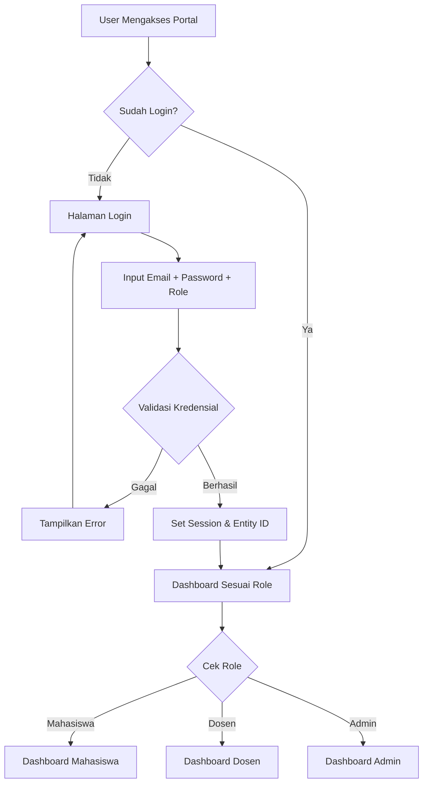
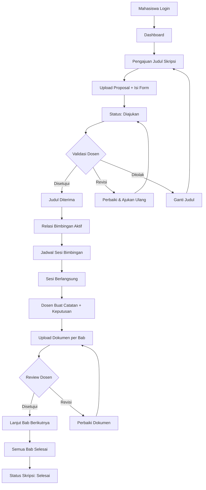
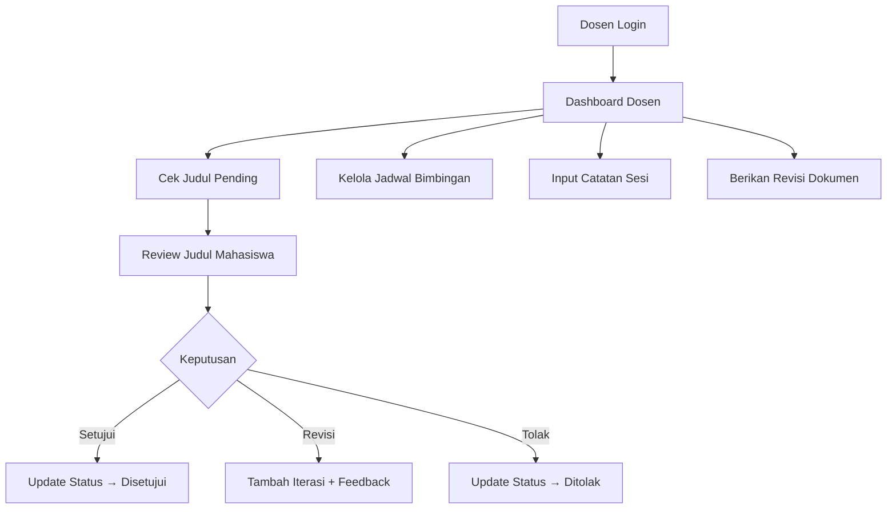
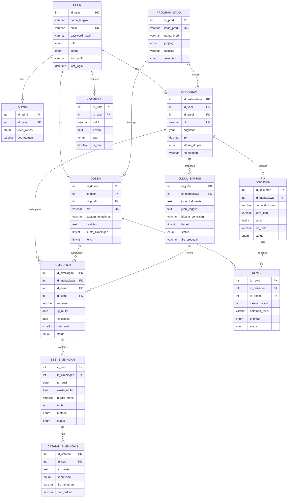

<](https://php.net)
[](https://mysql.com)
[](https://apachefriends.org)
[](https://

## 📖 Overview Project

**SkripsiKu** adalah portal manajemen bimbingan skripsi terpadu yang dirancang untuk memfasilitasi interaksi antara **mahasiswa**, **dosen pembimbing**, dan **administrator akademik** dalam satu ekosistem digital yang terintegrasi.

### 🎯 Tujuan Project

Membangun sistem informasi berbasis web yang mampu:

- Mendigitalisasi seluruh alur bimbingan skripsi dari pengajuan judul hingga penyelesaian
- Menyediakan transparansi progres antara mahasiswa dan dosen pembimbing
- Mempermudah administrator dalam monitoring dan pelaporan akademik
- Mengurangi miskomunikasi dan kehilangan dokumen fisik

### 👥 Target Pengguna

| Role | Deskripsi |
|------|-----------|
| **Mahasiswa** | Mengajukan judul, mengunggah dokumen, melihat jadwal & riwayat bimbingan |
| **Dosen** | Memvalidasi judul, memberikan catatan & revisi, mengelola jadwal konsultasi |
| **Admin** | Mengelola data user, relasi pembimbingan, laporan statistik, dan pengaturan sistem |

### 💡 Manfaat Aplikasi

- **Efisiensi** — Semua proses bimbingan tercatat digital, tidak perlu buku logbook fisik
- **Transparansi** — Mahasiswa dan dosen dapat memantau progres secara real-time
- **Akuntabilitas** — Setiap sesi bimbingan memiliki catatan dan keputusan yang terdokumentasi
- **Skalabilitas** — Mendukung multi program studi dengan kuota bimbingan yang terkelola

### ⚙️ Konsep Kerja Sistem

Sistem menggunakan arsitektur **3-role RBAC** (Role-Based Access Control) dimana setiap pengguna diarahkan ke dashboard dan menu navigasi yang sesuai dengan role-nya setelah login. Data tersimpan dalam database relasional MySQL dengan 12 tabel yang saling terhubung melalui foreign key, dilengkapi trigger otomatis untuk kalkulasi kuota dosen dan total sesi bimbingan.

---

## 🛠️ Tech Stack

| Teknologi | Versi | Kegunaan |
|-----------|-------|----------|
| **PHP Native** | 8.0+ | Backend logic, routing, session, CRUD |
| **MySQL** | 8.0+ | Database relasional dengan trigger & constraint |
| **PDO** | — | Secure database abstraction layer |
| **HTML5** | — | Struktur halaman & semantic markup |
| **CSS3** | — | Custom styling, responsive layout, glassmorphism |
| **JavaScript** | ES6+ | Interaktivitas UI, drag & drop, notifikasi |
| **Google Fonts** | — | Tipografi (Playfair Display, DM Sans, DM Mono) |
| **XAMPP** | Latest | Local server environment (Apache + MySQL) |
| **Antigravity** | — | AI-assisted code generation & pair programming |

---

## 📁 Struktur Folder Project

```bash
bimbingan-skripsi/
│
├── assets/                    # Static resources
│   ├── style.css              # Global stylesheet (24KB)
│   ├── script.js              # Client-side JavaScript
│   ├── logo.jpeg              # Logo utama
│   └── logo - 2.jpeg          # Logo alternatif
│
├── config/                    # Konfigurasi aplikasi
│   ├── app.php                # Konstanta (APP_NAME, BASE_URL, UPLOAD)
│   ├── db.php                 # Koneksi PDO + helper functions
│   └── auth.php               # Session, RBAC, flash message, helper
│
├── includes/                  # Reusable UI components
│   ├── header.php             # DOCTYPE, <head>, meta tags
│   ├── sidebar.php            # Navigasi role-based sidebar
│   ├── topbar.php             # Top navigation + notification panel
│   └── footer.php             # Script loader, closing tags
│
├── admin/                     # Modul Administrator
│   ├── mahasiswa.php          # CRUD data mahasiswa
│   ├── dosen.php              # CRUD data dosen
│   ├── relasi.php             # Kelola relasi pembimbingan
│   ├── laporan.php            # Laporan & statistik
│   └── pengaturan.php         # Pengaturan sistem
│
├── dosen/                     # Modul Dosen Pembimbing
│   ├── validasi.php           # Validasi judul skripsi
│   ├── mahasiswa.php          # Daftar mahasiswa bimbingan
│   ├── catatan.php            # Catatan bimbingan per sesi
│   └── jadwal.php             # Jadwal konsultasi
│
├── mahasiswa/                 # Modul Mahasiswa
│   ├── pengajuan.php          # Pengajuan judul skripsi
│   ├── dokumen.php            # Upload & kelola dokumen
│   ├── bimbingan.php          # Jadwal bimbingan
│   └── riwayat.php            # Riwayat sesi bimbingan
│
├── uploads/                   # File uploads (proposal, dokumen)
│
├── index.php                  # Login page (entry point)
├── dashboard.php              # Dashboard per role
├── profil.php                 # Halaman profil pengguna
├── logout.php                 # Session destroyer
├── db_bimbingan_skripsi.sql   # Database schema + seed + queries
├── task.md                    # Task specification
└── README.md                  # Dokumentasi project (file ini)
```

---

## 🔄 Workflow / Alur Kerja Sistem

### Alur Umum



### Alur Bimbingan Mahasiswa



### Alur Validasi Dosen



### Alur Proses Backend PHP

1. **Request Masuk** — Browser mengirim HTTP request ke file PHP
2. **Config Load** — `app.php`, `db.php`, `auth.php` dimuat berurutan
3. **Auth Check** — `requireLogin()` / `requireRole()` memvalidasi session
4. **Data Processing** — Query PDO dengan prepared statement ke MySQL
5. **Business Logic** — Validasi input, upload file, update status
6. **Trigger Execution** — MySQL trigger otomatis update `total_sesi` & `kuota_bimbingan`
7. **Response** — Render HTML dengan data terbaru + flash message

---

## 📐 ERD (Entity Relationship Diagram)

### Penjelasan Relasi Database

Sistem menggunakan **12 tabel** yang saling berelasi. Tabel `user` menjadi tabel induk autentikasi dengan relasi one-to-one ke `admin`, `mahasiswa`, dan `dosen`. Tabel `bimbingan` menjadi penghubung utama antara mahasiswa dan dosen melalui judul skripsi yang disetujui.

| Tabel | Primary Key | Foreign Key | Relasi |
|-------|-------------|-------------|--------|
| `program_studi` | `id_prodi` | — | Referensi utama prodi |
| `user` | `id_user` | — | Tabel induk autentikasi |
| `admin` | `id_admin` | `id_user` → `user` | 1:1 dengan user |
| `mahasiswa` | `id_mahasiswa` | `id_user` → `user`, `id_prodi` → `program_studi` | 1:1 dengan user |
| `dosen` | `id_dosen` | `id_user` → `user`, `id_prodi` → `program_studi` | 1:1 dengan user |
| `judul_skripsi` | `id_judul` | `id_mahasiswa` → `mahasiswa` | N:1 dengan mahasiswa |
| `bimbingan` | `id_bimbingan` | `id_mahasiswa`, `id_dosen`, `id_judul` | Relasi ternary |
| `sesi_bimbingan` | `id_sesi` | `id_bimbingan` → `bimbingan` | N:1 dengan bimbingan |
| `catatan_bimbingan` | `id_catatan` | `id_sesi` → `sesi_bimbingan` | N:1 dengan sesi |
| `dokumen` | `id_dokumen` | `id_mahasiswa` → `mahasiswa` | N:1 dengan mahasiswa |
| `revisi` | `id_revisi` | `id_dokumen` → `dokumen`, `id_dosen` → `dosen` | N:1 |
| `notifikasi` | `id_notif` | `id_user` → `user` | N:1 dengan user |

### Diagram ERD



---

## ✨ Fitur Utama

### 🔐 Autentikasi & Otorisasi
- Login multi-role (Mahasiswa / Dosen / Admin)
- Session management dengan PHP native session
- Role-based access control (RBAC)
- Validasi kredensial dengan SHA-256 hashing
- Auto-redirect berdasarkan role setelah login
- Tracking `last_login` timestamp

### 📝 Pengajuan Judul Skripsi
- Form pengajuan judul (Indonesia & Inggris)
- Upload file proposal (PDF/DOCX, maks 10MB)
- Tracking iterasi pengajuan
- Status workflow: `draft` → `diajukan` → `revisi/disetujui/ditolak`
- Riwayat pengajuan dengan versioning

### 📁 Manajemen Dokumen
- Upload dokumen per bab (BAB I – BAB V)
- Versioning otomatis
- Status review: `menunggu` → `direvisi` → `disetujui`
- Drag & drop upload zone
- Validasi format dan ukuran file

### 📋 Catatan & Revisi
- Catatan bimbingan oleh dosen setelah sesi
- Keputusan per catatan: `disetujui` / `revisi` / `ditolak`
- Revisi dokumen dengan prioritas: `minor` / `mayor` / `kritis`
- Tracking halaman revisi spesifik

### 🗓️ Jadwal Bimbingan
- Penjadwalan sesi bimbingan
- Multi-metode: Tatap Muka, Zoom, Google Meet
- Status sesi: `dijadwalkan` → `selesai` / `batal`
- Durasi per sesi tercatat

### 📊 Dashboard Role-Based
- **Mahasiswa**: Statistik sesi, revisi pending, dokumen per bab, timeline aktivitas
- **Dosen**: Jumlah mahasiswa, judul pending, sesi minggu ini, jadwal mendatang
- **Admin**: Total mahasiswa/dosen, statistik per prodi, log aktivitas

### 🔔 Sistem Notifikasi
- Notifikasi real-time per user
- Tipe: `info` / `sukses` / `peringatan` / `error`
- Panel notifikasi di topbar
- Badge counter untuk unread
- Notifikasi broadcast oleh admin

### 👤 Profil Pengguna
- Edit nama & no telepon
- Ganti password
- Info akademik (NIM/NIP, Prodi, Angkatan)
- Avatar inisial otomatis

### 📈 Laporan & Statistik (Admin)
- Rekapitulasi per program studi
- Distribusi status judul skripsi
- Mahasiswa tanpa pembimbing
- Kuota dosen tersisa
- Log aktivitas harian

### 🎨 UI/UX Modern
- Responsive layout (sidebar + topbar)
- Custom CSS design system
- Tipografi premium (Playfair Display + DM Sans)
- Badge status berwarna
- Timeline aktivitas
- Flash message auto-dismiss
- Empty state handling

---

## 🚀 Instalasi Project

### Prasyarat

- **XAMPP** (Apache + MySQL) — [Download](https://apachefriends.org)
- **PHP** 8.0 atau lebih baru
- **MySQL** 8.0 atau lebih baru
- **Browser** modern (Chrome, Firefox, Edge)

### Langkah Instalasi

**1. Clone Repository**

```bash
git clone https://github.com/username/bimbingan-skripsi.git
```

```bash
# Pindahkan ke folder htdocs XAMPP
# Windows:
copy bimbingan-skripsi C:\xampp\htdocs\basis-data-2\bimbingan-skripsi

# atau langsung clone ke htdocs:
cd C:\xampp\htdocs\basis-data-2
git clone https://github.com/username/bimbingan-skripsi.git
```

**2. Jalankan XAMPP**

```bash
# Buka XAMPP Control Panel
# Start Apache ✅
# Start MySQL ✅
```

**3. Import Database**

```bash
# Buka phpMyAdmin di browser
http://localhost/phpmyadmin

# Atau melalui command line:
mysql -u root -p < db_bimbingan_skripsi.sql
```

- Buka tab **Import**
- Pilih file `db_bimbingan_skripsi.sql`
- Klik **Go** / **Execute**
- Database `db_bimbingan_skripsi` akan otomatis terbuat beserta tabel, trigger, dan data seed

**4. Konfigurasi (Opsional)**

Edit `config/app.php` jika path berbeda:

```php
define('BASE_URL', 'http://localhost/basis-data-2/bimbingan-skripsi');
```

**5. Akses Aplikasi**

```
http://localhost/basis-data-2/bimbingan-skripsi/
```

### 🔑 Akun Demo

| Role | Email | Password |
|------|-------|----------|
| **Admin** | `admin@univ.ac.id` | `admin123` |
| **Dosen** | `sari.indah@univ.ac.id` | `dosen123` |
| **Mahasiswa** | `ahmad.fauzi@mhs.univ.ac.id` | `mhs123` |

---

## ⚙️ Konfigurasi Database

### File Koneksi: `config/db.php`

```php
<?php
define('DB_HOST', 'localhost');
define('DB_NAME', 'db_bimbingan_skripsi');
define('DB_USER', 'root');
define('DB_PASS', '');
define('DB_CHAR', 'utf8mb4');

function getDB(): PDO {
    static $pdo = null;
    if ($pdo === null) {
        $dsn = sprintf('mysql:host=%s;dbname=%s;charset=%s', DB_HOST, DB_NAME, DB_CHAR);
        $pdo = new PDO($dsn, DB_USER, DB_PASS, [
            PDO::ATTR_ERRMODE            => PDO::ERRMODE_EXCEPTION,
            PDO::ATTR_DEFAULT_FETCH_MODE => PDO::FETCH_ASSOC,
            PDO::ATTR_EMULATE_PREPARES   => false,
        ]);
    }
    return $pdo;
}
```

### Helper Functions

| Fungsi | Return | Kegunaan |
|--------|--------|----------|
| `fetchAll($sql, $params)` | `array` | Ambil semua baris hasil query |
| `fetchOne($sql, $params)` | `?array` | Ambil satu baris atau `null` |
| `execute($sql, $params)` | `int` | Eksekusi query, return last insert ID |
| `countRows($sql, $params)` | `int` | Hitung jumlah baris |

### File Konstanta: `config/app.php`

```php
<?php
define('APP_NAME',    'SkripsiKu');
define('APP_VERSION', '1.0.0');
define('BASE_URL',    'http://localhost/basis-data-2/bimbingan-skripsi');
define('UPLOAD_DIR',  __DIR__ . '/../uploads/');
define('UPLOAD_URL',  BASE_URL . '/uploads/');
define('MAX_FILE_KB', 10240); // 10 MB
```

---

## 📸 Screenshot

> Tambahkan screenshot tampilan aplikasi di folder `assets/` dan update path di bawah.

### Login Page


### Dashboard Mahasiswa


### Dashboard Dosen


### Dashboard Admin


### Pengajuan Judul


### Dokumen & Revisi


---

## 🔮 Future Development

| Fitur | Deskripsi | Prioritas |
|-------|-----------|-----------|
| 🔌 **REST API** | Endpoint API untuk integrasi mobile app & third-party | Tinggi |
| 🔑 **JWT Authentication** | Token-based auth menggantikan session untuk API | Tinggi |
| 📄 **Export PDF** | Cetak riwayat bimbingan & laporan dalam format PDF | Sedang |
| 🌙 **Dark Mode** | Tema gelap untuk kenyamanan pengguna | Sedang |
| 📧 **Email Notification** | Notifikasi via email untuk event penting | Sedang |
| 💬 **Real-time Chat** | Chat langsung antara mahasiswa dan dosen | Rendah |
| 📱 **PWA Support** | Progressive Web App untuk akses mobile offline | Rendah |
| 📊 **Analytics Dashboard** | Grafik & chart interaktif dengan Chart.js | Rendah |
| 🔍 **Full-text Search** | Pencarian judul skripsi dengan MySQL FULLTEXT | Rendah |
| 🛡️ **bcrypt Hashing** | Migrasi dari SHA-256 ke bcrypt/argon2 | Tinggi |

---

## 👨‍💻 Author

<div align="center">

**Kais Nabhan**

Mahasiswa — Universitas

[](https://github.com/username)

*Built with ❤️ using PHP Native + MySQL*
*Assisted by 🤖 Antigravity AI*

</div>

---

<div align="center">

**© 2025 SkripsiKu** — Portal Bimbingan Skripsi

`v1.0.0` · PHP Native · MySQL · Antigravity

</div>
]]>

, meta tags
│   ├── sidebar.php            # Navigasi role-based sidebar
│   ├── topbar.php             # Top navigation + notification panel
│   └── footer.php             # Script loader, closing tags
│
├── admin/                     # Modul Administrator
│   ├── mahasiswa.php          # CRUD data mahasiswa
│   ├── dosen.php              # CRUD data dosen
│   ├── relasi.php             # Kelola relasi pembimbingan
│   ├── laporan.php            # Laporan & statistik
│   └── pengaturan.php         # Pengaturan sistem
│
├── dosen/                     # Modul Dosen Pembimbing
│   ├── validasi.php           # Validasi judul skripsi
│   ├── mahasiswa.php          # Daftar mahasiswa bimbingan
│   ├── catatan.php            # Catatan bimbingan per sesi
│   └── jadwal.php             # Jadwal konsultasi
│── mahasiswa/                 # Modul Mahasiswa
│   ├── pengajuan.php          # Pengajuan judul skripsi
│   ├── dokumen.php            # Upload & kelola dokumen
│   ├── bimbingan.php          # Jadwal bimbingan
│   └── riwayat.php            # Riwayat sesi bimbingan
│
├── uploads/                   # File uploads (proposal, dokumen)
│
├── index.php                  # Login page (entry point)
├── dashboard.php              # Dashboard per role
├── profil.php                 # Halaman profil pengguna
├── logout.php                 # Session destroyer
├── db_bimbingan_skripsi.sql   # Database schema + seed + queries
├── task.md                    # Task specification
└── README.md                  # Dokumentasi project (file ini)

```

---

## 🔄 Workflow / Alur Kerja Sistem

### Alur Umum


### Alur Bimbingan Mahasiswa


### Alur Validasi Dosen


### Alur Proses Backend PHP

1. **Request Masuk** — Browser mengirim HTTP request ke file PHP
2. **Config Load** — `app.php`, `db.php`, `auth.php` dimuat berurutan
3. **Auth Check** — `requireLogin()` / `requireRole()` memvalidasi session
4. **Data Processing** — Query PDO dengan prepared statement ke MySQL
5. **Business Logic** — Validasi input, upload file, update status
6. **Trigger Execution** — MySQL trigger otomatis update `total_sesi` & `kuota_bimbingan`
7. **Response** — Render HTML dengan data terbaru + flash message

---

## 📐 ERD (Entity Relationship Diagram)

### Penjelasan Relasi Database

Sistem menggunakan **12 tabel** yang saling berelasi. Tabel `user` menjadi tabel induk autentikasi dengan relasi one-to-one ke `admin`, `mahasiswa`, dan `dosen`. Tabel `bimbingan` menjadi penghubung utama antara mahasiswa dan dosen melalui judul skripsi yang disetujui.

| Tabel                 | Primary Key      | Foreign Key                                                | Relasi                  |
| --------------------- | ---------------- | ---------------------------------------------------------- | ----------------------- |
| `program_studi`     | `id_prodi`     | —                                                         | Referensi utama prodi   |
| `user`              | `id_user`      | —                                                         | Tabel induk autentikasi |
| `admin`             | `id_admin`     | `id_user` → `user`                                    | 1:1 dengan user         |
| `mahasiswa`         | `id_mahasiswa` | `id_user` → `user`, `id_prodi` → `program_studi` | 1:1 dengan user         |
| `dosen`             | `id_dosen`     | `id_user` → `user`, `id_prodi` → `program_studi` | 1:1 dengan user         |
| `judul_skripsi`     | `id_judul`     | `id_mahasiswa` → `mahasiswa`                          | N:1 dengan mahasiswa    |
| `bimbingan`         | `id_bimbingan` | `id_mahasiswa`, `id_dosen`, `id_judul`               | Relasi ternary          |
| `sesi_bimbingan`    | `id_sesi`      | `id_bimbingan` → `bimbingan`                          | N:1 dengan bimbingan    |
| `catatan_bimbingan` | `id_catatan`   | `id_sesi` → `sesi_bimbingan`                          | N:1 dengan sesi         |
| `dokumen`           | `id_dokumen`   | `id_mahasiswa` → `mahasiswa`                          | N:1 dengan mahasiswa    |
| `revisi`            | `id_revisi`    | `id_dokumen` → `dokumen`, `id_dosen` → `dosen`   | N:1                     |
| `notifikasi`        | `id_notif`     | `id_user` → `user`                                    | N:1 dengan user         |

### Diagram ERD


---

## ✨ Fitur Utama

### 🔐 Autentikasi & Otorisasi

- Login multi-role (Mahasiswa / Dosen / Admin)
- Session management dengan PHP native session
- Role-based access control (RBAC)
- Validasi kredensial dengan SHA-256 hashing
- Auto-redirect berdasarkan role setelah login
- Tracking `last_login` timestamp

### 📝 Pengajuan Judul Skripsi

- Form pengajuan judul (Indonesia & Inggris)
- Upload file proposal (PDF/DOCX, maks 10MB)
- Tracking iterasi pengajuan
- Status workflow: `draft` → `diajukan` → `revisi/disetujui/ditolak`
- Riwayat pengajuan dengan versioning

### 📁 Manajemen Dokumen

- Upload dokumen per bab (BAB I – BAB V)
- Versioning otomatis
- Status review: `menunggu` → `direvisi` → `disetujui`
- Drag & drop upload zone
- Validasi format dan ukuran file

### 📋 Catatan & Revisi

- Catatan bimbingan oleh dosen setelah sesi
- Keputusan per catatan: `disetujui` / `revisi` / `ditolak`
- Revisi dokumen dengan prioritas: `minor` / `mayor` / `kritis`
- Tracking halaman revisi spesifik

### 🗓️ Jadwal Bimbingan

- Penjadwalan sesi bimbingan
- Multi-metode: Tatap Muka, Zoom, Google Meet
- Status sesi: `dijadwalkan` → `selesai` / `batal`
- Durasi per sesi tercatat

### 📊 Dashboard Role-Based

- **Mahasiswa**: Statistik sesi, revisi pending, dokumen per bab, timeline aktivitas
- **Dosen**: Jumlah mahasiswa, judul pending, sesi minggu ini, jadwal mendatang
- **Admin**: Total mahasiswa/dosen, statistik per prodi, log aktivitas

### 🔔 Sistem Notifikasi

- Notifikasi real-time per user
- Tipe: `info` / `sukses` / `peringatan` / `error`
- Panel notifikasi di topbar
- Badge counter untuk unread
- Notifikasi broadcast oleh admin

### 👤 Profil Pengguna

- Edit nama & no telepon
- Ganti password
- Info akademik (NIM/NIP, Prodi, Angkatan)
- Avatar inisial otomatis

### 📈 Laporan & Statistik (Admin)

- Rekapitulasi per program studi
- Distribusi status judul skripsi
- Mahasiswa tanpa pembimbing
- Kuota dosen tersisa
- Log aktivitas harian

### 🎨 UI/UX Modern

- Responsive layout (sidebar + topbar)
- Custom CSS design system
- Tipografi premium (Playfair Display + DM Sans)
- Badge status berwarna
- Timeline aktivitas
- Flash message auto-dismiss
- Empty state handling

---

## 🚀 Instalasi Project

### Prasyarat

- **XAMPP** (Apache + MySQL) — [Download](https://apachefriends.org)
- **PHP** 8.0 atau lebih baru
- **MySQL** 8.0 atau lebih baru
- **Browser** modern (Chrome, Firefox, Edge)

### Langkah Instalasi

**1. Clone Repository**

```bash
git clone https://github.com/username/bimbingan-skripsi.git
```

```bash
# Pindahkan ke folder htdocs XAMPP
# Windows:
copy bimbingan-skripsi C:\xampp\htdocs\basis-data-2\bimbingan-skripsi

# atau langsung clone ke htdocs:
cd C:\xampp\htdocs\basis-data-2
git clone https://github.com/username/bimbingan-skripsi.git
```

**2. Jalankan XAMPP**

```bash
# Buka XAMPP Control Panel
# Start Apache ✅
# Start MySQL ✅
```

**3. Import Database**

```bash
# Buka phpMyAdmin di browser
http://localhost/phpmyadmin

# Atau melalui command line:
mysql -u root -p < db_bimbingan_skripsi.sql
```

- Buka tab **Import**
- Pilih file `db_bimbingan_skripsi.sql`
- Klik **Go** / **Execute**
- Database `db_bimbingan_skripsi` akan otomatis terbuat beserta tabel, trigger, dan data seed

**4. Konfigurasi (Opsional)**

Edit `config/app.php` jika path berbeda:

```php
define('BASE_URL', 'http://localhost/basis-data-2/bimbingan-skripsi');
```

**5. Akses Aplikasi**

```
http://localhost/basis-data-2/bimbingan-skripsi/
```

### 🔑 Akun Demo

| Role                | Email                          | Password     |
| ------------------- | ------------------------------ | ------------ |
| **Admin**     | `admin@univ.ac.id`           | `admin123` |
| **Dosen**     | `sari.indah@univ.ac.id`      | `dosen123` |
| **Mahasiswa** | `ahmad.fauzi@mhs.univ.ac.id` | `mhs123`   |

---

## ⚙️ Konfigurasi Database

### File Koneksi: `config/db.php`

```php
 PDO::ERRMODE_EXCEPTION,
            PDO::ATTR_DEFAULT_FETCH_MODE => PDO::FETCH_ASSOC,
            PDO::ATTR_EMULATE_PREPARES   => false,
        ]);
    }
    return $pdo;
}
```

### Helper Functions

| Fungsi                       | Return     | Kegunaan                              |
| ---------------------------- | ---------- | ------------------------------------- |
| `fetchAll($sql, $params)`  | `array`  | Ambil semua baris hasil query         |
| `fetchOne($sql, $params)`  | `?array` | Ambil satu baris atau `null`        |
| `execute($sql, $params)`   | `int`    | Eksekusi query, return last insert ID |
| `countRows($sql, $params)` | `int`    | Hitung jumlah baris                   |

### File Konstanta: `config/app.php`

```php
 Tambahkan screenshot tampilan aplikasi di folder `assets/` dan update path di bawah.

### Login Page


### Dashboard Mahasiswa


### Dashboard Dosen


### Dashboard Admin


### Pengajuan Judul


### Dokumen & Revisi


---

## 🔮 Future Development

| Fitur | Deskripsi | Prioritas |
|-------|-----------|-----------|
| 🔌 **REST API** | Endpoint API untuk integrasi mobile app & third-party | Tinggi |
| 🔑 **JWT Authentication** | Token-based auth menggantikan session untuk API | Tinggi |
| 📄 **Export PDF** | Cetak riwayat bimbingan & laporan dalam format PDF | Sedang |
| 🌙 **Dark Mode** | Tema gelap untuk kenyamanan pengguna | Sedang |
| 📧 **Email Notification** | Notifikasi via email untuk event penting | Sedang |
| 💬 **Real-time Chat** | Chat langsung antara mahasiswa dan dosen | Rendah |
| 📱 **PWA Support** | Progressive Web App untuk akses mobile offline | Rendah |
| 📊 **Analytics Dashboard** | Grafik & chart interaktif dengan Chart.js | Rendah |
| 🔍 **Full-text Search** | Pencarian judul skripsi dengan MySQL FULLTEXT | Rendah |
| 🛡️ **bcrypt Hashing** | Migrasi dari SHA-256 ke bcrypt/argon2 | Tinggi |

---

## 👨‍💻 Author
```


**Kais Nabhan**

Mahasiswa — Universitas

[](https://github.com/username)

*Built with ❤️ using PHP Native + MySQL*
*Assisted by 🤖 Antigravity AI*


--


**© 2025 SkripsiKu** — Portal Bimbingan Skripsi

`v1.0.0` · PHP Native · MySQL · Antigravity


]

## 📖 Overview Project

**SkripsiKu** adalah portal manajemen bimbingan skripsi terpadu yang dirancang untuk memfasilitasi interaksi antara **mahasiswa**, **dosen pembimbing**, dan **administrator akademik** dalam satu ekosistem digital yang terintegrasi.

### 🎯 Tujuan Project

Membangun sistem informasi berbasis web yang mampu:

- Mendigitalisasi seluruh alur bimbingan skripsi dari pengajuan judul hingga penyelesaian
- Menyediakan transparansi progres antara mahasiswa dan dosen pembimbing
- Mempermudah administrator dalam monitoring dan pelaporan akademik
- Mengurangi miskomunikasi dan kehilangan dokumen fisik

### 👥 Target Pengguna

| Role                | Deskripsi                                                                          |
| ------------------- | ---------------------------------------------------------------------------------- |
| **Mahasiswa** | Mengajukan judul, mengunggah dokumen, melihat jadwal & riwayat bimbingan           |
| **Dosen**     | Memvalidasi judul, memberikan catatan & revisi, mengelola jadwal konsultasi        |
| **Admin**     | Mengelola data user, relasi pembimbingan, laporan statistik, dan pengaturan sistem |

### 💡 Manfaat Aplikasi

- **Efisiensi** — Semua proses bimbingan tercatat digital, tidak perlu buku logbook fisik
- **Transparansi** — Mahasiswa dan dosen dapat memantau progres secara real-time
- **Akuntabilitas** — Setiap sesi bimbingan memiliki catatan dan keputusan yang terdokumentasi
- **Skalabilitas** — Mendukung multi program studi dengan kuota bimbingan yang terkelola

### ⚙️ Konsep Kerja Sistem

Sistem menggunakan arsitektur **3-role RBAC** (Role-Based Access Control) dimana setiap pengguna diarahkan ke dashboard dan menu navigasi yang sesuai dengan role-nya setelah login. Data tersimpan dalam database relasional MySQL dengan 12 tabel yang saling terhubung melalui foreign key, dilengkapi trigger otomatis untuk kalkulasi kuota dosen dan total sesi bimbingan.

---

## 🛠️ Tech Stack

| Teknologi              | Versi  | Kegunaan                                         |
| ---------------------- | ------ | ------------------------------------------------ |
| **PHP Native**   | 8.0+   | Backend logic, routing, session, CRUD            |
| **MySQL**        | 8.0+   | Database relasional dengan trigger & constraint  |
| **PDO**          | —     | Secure database abstraction layer                |
| **HTML5**        | —     | Struktur halaman & semantic markup               |
| **CSS3**         | —     | Custom styling, responsive layout, glassmorphism |
| **JavaScript**   | ES6+   | Interaktivitas UI, drag & drop, notifikasi       |
| **Google Fonts** | —     | Tipografi (Playfair Display, DM Sans, DM Mono)   |
| **XAMPP**        | Latest | Local server environment (Apache + MySQL)        |
| **Antigravity**  | —     | AI-assisted code generation & pair programming   |

---

## 📁 Struktur Folder Project

```bash
bimbingan-skripsi/
│
├── assets/                    # Static resources
│   ├── style.css              # Global stylesheet (24KB)
│   ├── script.js              # Client-side JavaScript
│   ├── logo.jpeg              # Logo utama
│   └── logo - 2.jpeg          # Logo alternatif
│
├── config/                    # Konfigurasi aplikasi
│   ├── app.php                # Konstanta (APP_NAME, BASE_URL, UPLOAD)
│   ├── db.php                 # Koneksi PDO + helper functions
│   └── auth.php               # Session, RBAC, flash message, helper
│
├── includes/                  # Reusable UI components
│   ├── header.php             # DOCTYPE, , meta tags
│   ├── sidebar.php            # Navigasi role-based sidebar
│   ├── topbar.php             # Top navigation + notification panel
│   └── footer.php             # Script loader, closing tags
│
├── admin/                     # Modul Administrator
│   ├── mahasiswa.php          # CRUD data mahasiswa
│   ├── dosen.php              # CRUD data dosen
│   ├── relasi.php             # Kelola relasi pembimbingan
│   ├── laporan.php            # Laporan & statistik
│   └── pengaturan.php         # Pengaturan sistem
│
├── dosen/                     # Modul Dosen Pembimbing
│   ├── validasi.php           # Validasi judul skripsi
│   ├── mahasiswa.php          # Daftar mahasiswa bimbingan
│   ├── catatan.php            # Catatan bimbingan per sesi
│   └── jadwal.php             # Jadwal konsultasi
│
├── mahasiswa/                 # Modul Mahasiswa
│   ├── pengajuan.php          # Pengajuan judul skripsi
│   ├── dokumen.php            # Upload & kelola dokumen
│   ├── bimbingan.php          # Jadwal bimbingan
│   └── riwayat.php            # Riwayat sesi bimbingan
│
├── uploads/                   # File uploads (proposal, dokumen)
│
├── index.php                  # Login page (entry point)
├── dashboard.php              # Dashboard per role
├── profil.php                 # Halaman profil pengguna
├── logout.php                 # Session destroyer
├── db_bimbingan_skripsi.sql   # Database schema + seed + queries
├── task.md                    # Task specification
└── README.md                  # Dokumentasi project (file ini)
```

---

## 🔄 Workflow / Alur Kerja Sistem

### Alur Umum


### Alur Bimbingan Mahasiswa


### Alur Validasi Dosen


### Alur Proses Backend PHP

1. **Request Masuk** — Browser mengirim HTTP request ke file PHP
2. **Config Load** — `app.php`, `db.php`, `auth.php` dimuat berurutan
3. **Auth Check** — `requireLogin()` / `requireRole()` memvalidasi session
4. **Data Processing** — Query PDO dengan prepared statement ke MySQL
5. **Business Logic** — Validasi input, upload file, update status
6. **Trigger Execution** — MySQL trigger otomatis update `total_sesi` & `kuota_bimbingan`
7. **Response** — Render HTML dengan data terbaru + flash message

---

## 📐 ERD (Entity Relationship Diagram)

### Penjelasan Relasi Database

Sistem menggunakan **12 tabel** yang saling berelasi. Tabel `user` menjadi tabel induk autentikasi dengan relasi one-to-one ke `admin`, `mahasiswa`, dan `dosen`. Tabel `bimbingan` menjadi penghubung utama antara mahasiswa dan dosen melalui judul skripsi yang disetujui.

| Tabel                 | Primary Key      | Foreign Key                                                | Relasi                  |
| --------------------- | ---------------- | ---------------------------------------------------------- | ----------------------- |
| `program_studi`     | `id_prodi`     | —                                                         | Referensi utama prodi   |
| `user`              | `id_user`      | —                                                         | Tabel induk autentikasi |
| `admin`             | `id_admin`     | `id_user` → `user`                                    | 1:1 dengan user         |
| `mahasiswa`         | `id_mahasiswa` | `id_user` → `user`, `id_prodi` → `program_studi` | 1:1 dengan user         |
| `dosen`             | `id_dosen`     | `id_user` → `user`, `id_prodi` → `program_studi` | 1:1 dengan user         |
| `judul_skripsi`     | `id_judul`     | `id_mahasiswa` → `mahasiswa`                          | N:1 dengan mahasiswa    |
| `bimbingan`         | `id_bimbingan` | `id_mahasiswa`, `id_dosen`, `id_judul`               | Relasi ternary          |
| `sesi_bimbingan`    | `id_sesi`      | `id_bimbingan` → `bimbingan`                          | N:1 dengan bimbingan    |
| `catatan_bimbingan` | `id_catatan`   | `id_sesi` → `sesi_bimbingan`                          | N:1 dengan sesi         |
| `dokumen`           | `id_dokumen`   | `id_mahasiswa` → `mahasiswa`                          | N:1 dengan mahasiswa    |
| `revisi`            | `id_revisi`    | `id_dokumen` → `dokumen`, `id_dosen` → `dosen`   | N:1                     |
| `notifikasi`        | `id_notif`     | `id_user` → `user`                                    | N:1 dengan user         |

### Diagram ERD


---

## ✨ Fitur Utama

### 🔐 Autentikasi & Otorisasi

- Login multi-role (Mahasiswa / Dosen / Admin)
- Session management dengan PHP native session
- Role-based access control (RBAC)
- Validasi kredensial dengan SHA-256 hashing
- Auto-redirect berdasarkan role setelah login
- Tracking `last_login` timestamp

### 📝 Pengajuan Judul Skripsi

- Form pengajuan judul (Indonesia & Inggris)
- Upload file proposal (PDF/DOCX, maks 10MB)
- Tracking iterasi pengajuan
- Status workflow: `draft` → `diajukan` → `revisi/disetujui/ditolak`
- Riwayat pengajuan dengan versioning

### 📁 Manajemen Dokumen

- Upload dokumen per bab (BAB I – BAB V)
- Versioning otomatis
- Status review: `menunggu` → `direvisi` → `disetujui`
- Drag & drop upload zone
- Validasi format dan ukuran file

### 📋 Catatan & Revisi

- Catatan bimbingan oleh dosen setelah sesi
- Keputusan per catatan: `disetujui` / `revisi` / `ditolak`
- Revisi dokumen dengan prioritas: `minor` / `mayor` / `kritis`
- Tracking halaman revisi spesifik

### 🗓️ Jadwal Bimbingan

- Penjadwalan sesi bimbingan
- Multi-metode: Tatap Muka, Zoom, Google Meet
- Status sesi: `dijadwalkan` → `selesai` / `batal`
- Durasi per sesi tercatat

### 📊 Dashboard Role-Based

- **Mahasiswa**: Statistik sesi, revisi pending, dokumen per bab, timeline aktivitas
- **Dosen**: Jumlah mahasiswa, judul pending, sesi minggu ini, jadwal mendatang
- **Admin**: Total mahasiswa/dosen, statistik per prodi, log aktivitas

### 🔔 Sistem Notifikasi

- Notifikasi real-time per user
- Tipe: `info` / `sukses` / `peringatan` / `error`
- Panel notifikasi di topbar
- Badge counter untuk unread
- Notifikasi broadcast oleh admin

### 👤 Profil Pengguna

- Edit nama & no telepon
- Ganti password
- Info akademik (NIM/NIP, Prodi, Angkatan)
- Avatar inisial otomatis

### 📈 Laporan & Statistik (Admin)

- Rekapitulasi per program studi
- Distribusi status judul skripsi
- Mahasiswa tanpa pembimbing
- Kuota dosen tersisa
- Log aktivitas harian

### 🎨 UI/UX Modern

- Responsive layout (sidebar + topbar)
- Custom CSS design system
- Tipografi premium (Playfair Display + DM Sans)
- Badge status berwarna
- Timeline aktivitas
- Flash message auto-dismiss
- Empty state handling

---

## 🚀 Instalasi Project

### Prasyarat

- **XAMPP** (Apache + MySQL) — [Download](https://apachefriends.org)
- **PHP** 8.0 atau lebih baru
- **MySQL** 8.0 atau lebih baru
- **Browser** modern (Chrome, Firefox, Edge)

### Langkah Instalasi

**1. Clone Repository**

```bash
git clone https://github.com/username/bimbingan-skripsi.git
```

```bash
# Pindahkan ke folder htdocs XAMPP
# Windows:
copy bimbingan-skripsi C:\xampp\htdocs\basis-data-2\bimbingan-skripsi

# atau langsung clone ke htdocs:
cd C:\xampp\htdocs\basis-data-2
git clone https://github.com/username/bimbingan-skripsi.git
```

**2. Jalankan XAMPP**

```bash
# Buka XAMPP Control Panel
# Start Apache ✅
# Start MySQL ✅
```

**3. Import Database**

```bash
# Buka phpMyAdmin di browser
http://localhost/phpmyadmin

# Atau melalui command line:
mysql -u root -p < db_bimbingan_skripsi.sql
```

- Buka tab **Import**
- Pilih file `db_bimbingan_skripsi.sql`
- Klik **Go** / **Execute**
- Database `db_bimbingan_skripsi` akan otomatis terbuat beserta tabel, trigger, dan data seed

**4. Konfigurasi (Opsional)**

Edit `config/app.php` jika path berbeda:

```php
define('BASE_URL', 'http://localhost/basis-data-2/bimbingan-skripsi');
```

**5. Akses Aplikasi**

```
http://localhost/basis-data-2/bimbingan-skripsi/
```

### 🔑 Akun Demo

| Role                | Email                          | Password     |
| ------------------- | ------------------------------ | ------------ |
| **Admin**     | `admin@univ.ac.id`           | `admin123` |
| **Dosen**     | `sari.indah@univ.ac.id`      | `dosen123` |
| **Mahasiswa** | `ahmad.fauzi@mhs.univ.ac.id` | `mhs123`   |

---

## ⚙️ Konfigurasi Database

### File Koneksi: `config/db.php`

```php
 PDO::ERRMODE_EXCEPTION,
            PDO::ATTR_DEFAULT_FETCH_MODE => PDO::FETCH_ASSOC,
            PDO::ATTR_EMULATE_PREPARES   => false,
        ]);
    }
    return $pdo;
}
```

### Helper Functions

| Fungsi                       | Return     | Kegunaan                              |
| ---------------------------- | ---------- | ------------------------------------- |
| `fetchAll($sql, $params)`  | `array`  | Ambil semua baris hasil query         |
| `fetchOne($sql, $params)`  | `?array` | Ambil satu baris atau `null`        |
| `execute($sql, $params)`   | `int`    | Eksekusi query, return last insert ID |
| `countRows($sql, $params)` | `int`    | Hitung jumlah baris                   |

### File Konstanta: `config/app.php`

```php
 Tambahkan screenshot tampilan aplikasi di folder `assets/` dan update path di bawah.

### Login Page


### Dashboard Mahasiswa


### Dashboard Dosen


### Dashboard Admin


### Pengajuan Judul


### Dokumen & Revisi


---

## 🔮 Future Development

| Fitur | Deskripsi | Prioritas |
|-------|-----------|-----------|
| 🔌 **REST API** | Endpoint API untuk integrasi mobile app & third-party | Tinggi |
| 🔑 **JWT Authentication** | Token-based auth menggantikan session untuk API | Tinggi |
| 📄 **Export PDF** | Cetak riwayat bimbingan & laporan dalam format PDF | Sedang |
| 🌙 **Dark Mode** | Tema gelap untuk kenyamanan pengguna | Sedang |
| 📧 **Email Notification** | Notifikasi via email untuk event penting | Sedang |
| 💬 **Real-time Chat** | Chat langsung antara mahasiswa dan dosen | Rendah |
| 📱 **PWA Support** | Progressive Web App untuk akses mobile offline | Rendah |
| 📊 **Analytics Dashboard** | Grafik & chart interaktif dengan Chart.js | Rendah |
| 🔍 **Full-text Search** | Pencarian judul skripsi dengan MySQL FULLTEXT | Rendah |
| 🛡️ **bcrypt Hashing** | Migrasi dari SHA-256 ke bcrypt/argon2 | Tinggi |

---

## 👨‍💻 Author
```


**Kais Nabhan**

Mahasiswa — Universitas

[](https://github.com/username)

*Built with ❤️ using PHP Native + MySQL*
*Assisted by 🤖 Antigravity AI*

---


**© 2025 SkripsiKu** — Portal Bimbingan Skripsi

`v1.0.0` · PHP Native · MySQL · Antigravity
]]>

## 📖 Overview Project

**SkripsiKu** adalah portal manajemen bimbingan skripsi terpadu yang dirancang untuk memfasilitasi interaksi antara **mahasiswa**, **dosen pembimbing**, dan **administrator akademik** dalam satu ekosistem digital yang terintegrasi.

### 🎯 Tujuan Project

Membangun sistem informasi berbasis web yang mampu:

- Mendigitalisasi seluruh alur bimbingan skripsi dari pengajuan judul hingga penyelesaian
- Menyediakan transparansi progres antara mahasiswa dan dosen pembimbing
- Mempermudah administrator dalam monitoring dan pelaporan akademik
- Mengurangi miskomunikasi dan kehilangan dokumen fisik

### 👥 Target Pengguna

| Role                | Deskripsi                                                                          |
| ------------------- | ---------------------------------------------------------------------------------- |
| **Mahasiswa** | Mengajukan judul, mengunggah dokumen, melihat jadwal & riwayat bimbingan           |
| **Dosen**     | Memvalidasi judul, memberikan catatan & revisi, mengelola jadwal konsultasi        |
| **Admin**     | Mengelola data user, relasi pembimbingan, laporan statistik, dan pengaturan sistem |

### 💡 Manfaat Aplikasi

- **Efisiensi** — Semua proses bimbingan tercatat digital, tidak perlu buku logbook fisik
- **Transparansi** — Mahasiswa dan dosen dapat memantau progres secara real-time
- **Akuntabilitas** — Setiap sesi bimbingan memiliki catatan dan keputusan yang terdokumentasi
- **Skalabilitas** — Mendukung multi program studi dengan kuota bimbingan yang terkelola

### ⚙️ Konsep Kerja Sistem

Sistem menggunakan arsitektur **3-role RBAC** (Role-Based Access Control) dimana setiap pengguna diarahkan ke dashboard dan menu navigasi yang sesuai dengan role-nya setelah login. Data tersimpan dalam database relasional MySQL dengan 12 tabel yang saling terhubung melalui foreign key, dilengkapi trigger otomatis untuk kalkulasi kuota dosen dan total sesi bimbingan.

---

## 🛠️ Tech Stack

| Teknologi              | Versi  | Kegunaan                                         |
| ---------------------- | ------ | ------------------------------------------------ |
| **PHP Native**   | 8.0+   | Backend logic, routing, session, CRUD            |
| **MySQL**        | 8.0+   | Database relasional dengan trigger & constraint  |
| **PDO**          | —     | Secure database abstraction layer                |
| **HTML5**        | —     | Struktur halaman & semantic markup               |
| **CSS3**         | —     | Custom styling, responsive layout, glassmorphism |
| **JavaScript**   | ES6+   | Interaktivitas UI, drag & drop, notifikasi       |
| **Google Fonts** | —     | Tipografi (Playfair Display, DM Sans, DM Mono)   |
| **XAMPP**        | Latest | Local server environment (Apache + MySQL)        |
| **Antigravity**  | —     | AI-assisted code generation & pair programming   |

---

## 📁 Struktur Folder Project

```bash
bimbingan-skripsi/
│
├── assets/                    # Static resources
│   ├── style.css              # Global stylesheet (24KB)
│   ├── script.js              # Client-side JavaScript
│   ├── logo.jpeg              # Logo utama
│   └── logo - 2.jpeg          # Logo alternatif
│
├── config/                    # Konfigurasi aplikasi
│   ├── app.php                # Konstanta (APP_NAME, BASE_URL, UPLOAD)
│   ├── db.php                 # Koneksi PDO + helper functions
│   └── auth.php               # Session, RBAC, flash message, helper
│
├── includes/                  # Reusable UI components
│   ├── header.php             # DOCTYPE, , meta tags
│   ├── sidebar.php            # Navigasi role-based sidebar
│   ├── topbar.php             # Top navigation + notification panel
│   └── footer.php             # Script loader, closing tags
│
├── admin/                     # Modul Administrator
│   ├── mahasiswa.php          # CRUD data mahasiswa
│   ├── dosen.php              # CRUD data dosen
│   ├── relasi.php             # Kelola relasi pembimbingan
│   ├── laporan.php            # Laporan & statistik
│   └── pengaturan.php         # Pengaturan sistem
│
├── dosen/                     # Modul Dosen Pembimbing
│   ├── validasi.php           # Validasi judul skripsi
│   ├── mahasiswa.php          # Daftar mahasiswa bimbingan
│   ├── catatan.php            # Catatan bimbingan per sesi
│   └── jadwal.php             # Jadwal konsultasi
│
├── mahasiswa/                 # Modul Mahasiswa
│   ├── pengajuan.php          # Pengajuan judul skripsi
│   ├── dokumen.php            # Upload & kelola dokumen
│   ├── bimbingan.php          # Jadwal bimbingan
│   └── riwayat.php            # Riwayat sesi bimbingan
│
├── uploads/                   # File uploads (proposal, dokumen)
│
├── index.php                  # Login page (entry point)
├── dashboard.php              # Dashboard per role
├── profil.php                 # Halaman profil pengguna
├── logout.php                 # Session destroyer
├── db_bimbingan_skripsi.sql   # Database schema + seed + queries
├── task.md                    # Task specification
└── README.md                  # Dokumentasi project (file ini)
```

---

## 🔄 Workflow / Alur Kerja Sistem

### Alur Umum


### Alur Bimbingan Mahasiswa


### Alur Validasi Dosen


### Alur Proses Backend PHP

1. **Request Masuk** — Browser mengirim HTTP request ke file PHP
2. **Config Load** — `app.php`, `db.php`, `auth.php` dimuat berurutan
3. **Auth Check** — `requireLogin()` / `requireRole()` memvalidasi session
4. **Data Processing** — Query PDO dengan prepared statement ke MySQL
5. **Business Logic** — Validasi input, upload file, update status
6. **Trigger Execution** — MySQL trigger otomatis update `total_sesi` & `kuota_bimbingan`
7. **Response** — Render HTML dengan data terbaru + flash message

---

## 📐 ERD (Entity Relationship Diagram)

### Penjelasan Relasi Database

Sistem menggunakan **12 tabel** yang saling berelasi. Tabel `user` menjadi tabel induk autentikasi dengan relasi one-to-one ke `admin`, `mahasiswa`, dan `dosen`. Tabel `bimbingan` menjadi penghubung utama antara mahasiswa dan dosen melalui judul skripsi yang disetujui.

| Tabel                 | Primary Key      | Foreign Key                                                | Relasi                  |
| --------------------- | ---------------- | ---------------------------------------------------------- | ----------------------- |
| `program_studi`     | `id_prodi`     | —                                                         | Referensi utama prodi   |
| `user`              | `id_user`      | —                                                         | Tabel induk autentikasi |
| `admin`             | `id_admin`     | `id_user` → `user`                                    | 1:1 dengan user         |
| `mahasiswa`         | `id_mahasiswa` | `id_user` → `user`, `id_prodi` → `program_studi` | 1:1 dengan user         |
| `dosen`             | `id_dosen`     | `id_user` → `user`, `id_prodi` → `program_studi` | 1:1 dengan user         |
| `judul_skripsi`     | `id_judul`     | `id_mahasiswa` → `mahasiswa`                          | N:1 dengan mahasiswa    |
| `bimbingan`         | `id_bimbingan` | `id_mahasiswa`, `id_dosen`, `id_judul`               | Relasi ternary          |
| `sesi_bimbingan`    | `id_sesi`      | `id_bimbingan` → `bimbingan`                          | N:1 dengan bimbingan    |
| `catatan_bimbingan` | `id_catatan`   | `id_sesi` → `sesi_bimbingan`                          | N:1 dengan sesi         |
| `dokumen`           | `id_dokumen`   | `id_mahasiswa` → `mahasiswa`                          | N:1 dengan mahasiswa    |
| `revisi`            | `id_revisi`    | `id_dokumen` → `dokumen`, `id_dosen` → `dosen`   | N:1                     |
| `notifikasi`        | `id_notif`     | `id_user` → `user`                                    | N:1 dengan user         |

### Diagram ERD


---

## ✨ Fitur Utama

### 🔐 Autentikasi & Otorisasi

- Login multi-role (Mahasiswa / Dosen / Admin)
- Session management dengan PHP native session
- Role-based access control (RBAC)
- Validasi kredensial dengan SHA-256 hashing
- Auto-redirect berdasarkan role setelah login
- Tracking `last_login` timestamp

### 📝 Pengajuan Judul Skripsi

- Form pengajuan judul (Indonesia & Inggris)
- Upload file proposal (PDF/DOCX, maks 10MB)
- Tracking iterasi pengajuan
- Status workflow: `draft` → `diajukan` → `revisi/disetujui/ditolak`
- Riwayat pengajuan dengan versioning

### 📁 Manajemen Dokumen

- Upload dokumen per bab (BAB I – BAB V)
- Versioning otomatis
- Status review: `menunggu` → `direvisi` → `disetujui`
- Drag & drop upload zone
- Validasi format dan ukuran file

### 📋 Catatan & Revisi

- Catatan bimbingan oleh dosen setelah sesi
- Keputusan per catatan: `disetujui` / `revisi` / `ditolak`
- Revisi dokumen dengan prioritas: `minor` / `mayor` / `kritis`
- Tracking halaman revisi spesifik

### 🗓️ Jadwal Bimbingan

- Penjadwalan sesi bimbingan
- Multi-metode: Tatap Muka, Zoom, Google Meet
- Status sesi: `dijadwalkan` → `selesai` / `batal`
- Durasi per sesi tercatat

### 📊 Dashboard Role-Based

- **Mahasiswa**: Statistik sesi, revisi pending, dokumen per bab, timeline aktivitas
- **Dosen**: Jumlah mahasiswa, judul pending, sesi minggu ini, jadwal mendatang
- **Admin**: Total mahasiswa/dosen, statistik per prodi, log aktivitas

### 🔔 Sistem Notifikasi

- Notifikasi real-time per user
- Tipe: `info` / `sukses` / `peringatan` / `error`
- Panel notifikasi di topbar
- Badge counter untuk unread
- Notifikasi broadcast oleh admin

### 👤 Profil Pengguna

- Edit nama & no telepon
- Ganti password
- Info akademik (NIM/NIP, Prodi, Angkatan)
- Avatar inisial otomatis

### 📈 Laporan & Statistik (Admin)

- Rekapitulasi per program studi
- Distribusi status judul skripsi
- Mahasiswa tanpa pembimbing
- Kuota dosen tersisa
- Log aktivitas harian

### 🎨 UI/UX Modern

- Responsive layout (sidebar + topbar)
- Custom CSS design system
- Tipografi premium (Playfair Display + DM Sans)
- Badge status berwarna
- Timeline aktivitas
- Flash message auto-dismiss
- Empty state handling

---

## 🚀 Instalasi Project

### Prasyarat

- **XAMPP** (Apache + MySQL) — [Download](https://apachefriends.org)
- **PHP** 8.0 atau lebih baru
- **MySQL** 8.0 atau lebih baru
- **Browser** modern (Chrome, Firefox, Edge)

### Langkah Instalasi

**1. Clone Repository**

```bash
git clone https://github.com/username/bimbingan-skripsi.git
```

```bash
# Pindahkan ke folder htdocs XAMPP
# Windows:
copy bimbingan-skripsi C:\xampp\htdocs\basis-data-2\bimbingan-skripsi

# atau langsung clone ke htdocs:
cd C:\xampp\htdocs\basis-data-2
git clone https://github.com/username/bimbingan-skripsi.git
```

**2. Jalankan XAMPP**

```bash
# Buka XAMPP Control Panel
# Start Apache ✅
# Start MySQL ✅
```

**3. Import Database**

```bash
# Buka phpMyAdmin di browser
http://localhost/phpmyadmin

# Atau melalui command line:
mysql -u root -p < db_bimbingan_skripsi.sql
```

- Buka tab **Import**
- Pilih file `db_bimbingan_skripsi.sql`
- Klik **Go** / **Execute**
- Database `db_bimbingan_skripsi` akan otomatis terbuat beserta tabel, trigger, dan data seed

**4. Konfigurasi (Opsional)**

Edit `config/app.php` jika path berbeda:

```php
define('BASE_URL', 'http://localhost/basis-data-2/bimbingan-skripsi');
```

**5. Akses Aplikasi**

```
http://localhost/basis-data-2/bimbingan-skripsi/
```

### 🔑 Akun Demo

| Role                | Email                          | Password     |
| ------------------- | ------------------------------ | ------------ |
| **Admin**     | `admin@univ.ac.id`           | `admin123` |
| **Dosen**     | `sari.indah@univ.ac.id`      | `dosen123` |
| **Mahasiswa** | `ahmad.fauzi@mhs.univ.ac.id` | `mhs123`   |

---

## ⚙️ Konfigurasi Database

### File Koneksi: `config/db.php`

```php
 PDO::ERRMODE_EXCEPTION,
            PDO::ATTR_DEFAULT_FETCH_MODE => PDO::FETCH_ASSOC,
            PDO::ATTR_EMULATE_PREPARES   => false,
        ]);
    }
    return $pdo;
}
```

### Helper Functions

| Fungsi                       | Return     | Kegunaan                              |
| ---------------------------- | ---------- | ------------------------------------- |
| `fetchAll($sql, $params)`  | `array`  | Ambil semua baris hasil query         |
| `fetchOne($sql, $params)`  | `?array` | Ambil satu baris atau `null`        |
| `execute($sql, $params)`   | `int`    | Eksekusi query, return last insert ID |
| `countRows($sql, $params)` | `int`    | Hitung jumlah baris                   |

### File Konstanta: `config/app.php`

```php
 Tambahkan screenshot tampilan aplikasi di folder `assets/` dan update path di bawah.

### Login Page


### Dashboard Mahasiswa


### Dashboard Dosen


### Dashboard Admin


### Pengajuan Judul


### Dokumen & Revisi


---

## 🔮 Future Development

| Fitur | Deskripsi | Prioritas |
|-------|-----------|-----------|
| 🔌 **REST API** | Endpoint API untuk integrasi mobile app & third-party | Tinggi |
| 🔑 **JWT Authentication** | Token-based auth menggantikan session untuk API | Tinggi |
| 📄 **Export PDF** | Cetak riwayat bimbingan & laporan dalam format PDF | Sedang |
| 🌙 **Dark Mode** | Tema gelap untuk kenyamanan pengguna | Sedang |
| 📧 **Email Notification** | Notifikasi via email untuk event penting | Sedang |
| 💬 **Real-time Chat** | Chat langsung antara mahasiswa dan dosen | Rendah |
| 📱 **PWA Support** | Progressive Web App untuk akses mobile offline | Rendah |
| 📊 **Analytics Dashboard** | Grafik & chart interaktif dengan Chart.js | Rendah |
| 🔍 **Full-text Search** | Pencarian judul skripsi dengan MySQL FULLTEXT | Rendah |
| 🛡️ **bcrypt Hashing** | Migrasi dari SHA-256 ke bcrypt/argon2 | Tinggi |

---

## 👨‍💻 Author
```


**Kais Nabhan**

Mahasiswa — Universitas

[](https://github.com/username)

*Built with ❤️ using PHP Native + MySQL*
*Assisted by 🤖 Antigravity AI*


--


**© 2025 SkripsiKu** — Portal Bimbingan Skripsi

`v1.0.0` · PHP Native · MySQL · Antigravity


]

--

## 📖 Overview Project

**SkripsiKu** adalah portal manajemen bimbingan skripsi terpadu yang dirancang untuk memfasilitasi interaksi antara **mahasiswa**, **dosen pembimbing**, dan **administrator akademik** dalam satu ekosistem digital yang terintegrasi.

### 🎯 Tujuan Project

Membangun sistem informasi berbasis web yang mampu:

- Mendigitalisasi seluruh alur bimbingan skripsi dari pengajuan judul hingga penyelesaian
- Menyediakan transparansi progres antara mahasiswa dan dosen pembimbing
- Mempermudah administrator dalam monitoring dan pelaporan akademik
- Mengurangi miskomunikasi dan kehilangan dokumen fisik

### 👥 Target Pengguna

| Role                | Deskripsi                                                                          |
| ------------------- | ---------------------------------------------------------------------------------- |
| **Mahasiswa** | Mengajukan judul, mengunggah dokumen, melihat jadwal & riwayat bimbingan           |
| **Dosen**     | Memvalidasi judul, memberikan catatan & revisi, mengelola jadwal konsultasi        |
| **Admin**     | Mengelola data user, relasi pembimbingan, laporan statistik, dan pengaturan sistem |

### 💡 Manfaat Aplikasi

- **Efisiensi** — Semua proses bimbingan tercatat digital, tidak perlu buku logbook fisik
- **Transparansi** — Mahasiswa dan dosen dapat memantau progres secara real-time
- **Akuntabilitas** — Setiap sesi bimbingan memiliki catatan dan keputusan yang terdokumentasi
- **Skalabilitas** — Mendukung multi program studi dengan kuota bimbingan yang terkelola

### ⚙️ Konsep Kerja Sistem

Sistem menggunakan arsitektur **3-role RBAC** (Role-Based Access Control) dimana setiap pengguna diarahkan ke dashboard dan menu navigasi yang sesuai dengan role-nya setelah login. Data tersimpan dalam database relasional MySQL dengan 12 tabel yang saling terhubung melalui foreign key, dilengkapi trigger otomatis untuk kalkulasi kuota dosen dan total sesi bimbingan.

---

## 🛠️ Tech Stack

| Teknologi              | Versi  | Kegunaan                                         |
| ---------------------- | ------ | ------------------------------------------------ |
| **PHP Native**   | 8.0+   | Backend logic, routing, session, CRUD            |
| **MySQL**        | 8.0+   | Database relasional dengan trigger & constraint  |
| **PDO**          | —     | Secure database abstraction layer                |
| **HTML5**        | —     | Struktur halaman & semantic markup               |
| **CSS3**         | —     | Custom styling, responsive layout, glassmorphism |
| **JavaScript**   | ES6+   | Interaktivitas UI, drag & drop, notifikasi       |
| **Google Fonts** | —     | Tipografi (Playfair Display, DM Sans, DM Mono)   |
| **XAMPP**        | Latest | Local server environment (Apache + MySQL)        |
| **Antigravity**  | —     | AI-assisted code generation & pair programming   |

---

## 📁 Struktur Folder Project

```bash
bimbingan-skripsi/
│
├── assets/                    # Static resources
│   ├── style.css              # Global stylesheet (24KB)
│   ├── script.js              # Client-side JavaScript
│   ├── logo.jpeg              # Logo utama
│   └── logo - 2.jpeg          # Logo alternatif
│
├── config/                    # Konfigurasi aplikasi
│   ├── app.php                # Konstanta (APP_NAME, BASE_URL, UPLOAD)
│   ├── db.php                 # Koneksi PDO + helper functions
│   └── auth.php               # Session, RBAC, flash message, helper
│
├── includes/                  # Reusable UI components
│   ├── header.php             # DOCTYPE, , meta tags
│   ├── sidebar.php            # Navigasi role-based sidebar
│   ├── topbar.php             # Top navigation + notification panel
│   └── footer.php             # Script loader, closing tags
│
├── admin/                     # Modul Administrator
│   ├── mahasiswa.php          # CRUD data mahasiswa
│   ├── dosen.php              # CRUD data dosen
│   ├── relasi.php             # Kelola relasi pembimbingan
│   ├── laporan.php            # Laporan & statistik
│   └── pengaturan.php         # Pengaturan sistem
│
├── dosen/                     # Modul Dosen Pembimbing
│   ├── validasi.php           # Validasi judul skripsi
│   ├── mahasiswa.php          # Daftar mahasiswa bimbingan
│   ├── catatan.php            # Catatan bimbingan per sesi
│   └── jadwal.php             # Jadwal konsultasi
│
├── mahasiswa/                 # Modul Mahasiswa
│   ├── pengajuan.php          # Pengajuan judul skripsi
│   ├── dokumen.php            # Upload & kelola dokumen
│   ├── bimbingan.php          # Jadwal bimbingan
│   └── riwayat.php            # Riwayat sesi bimbingan
│
├── uploads/                   # File uploads (proposal, dokumen)
│
├── index.php                  # Login page (entry point)
├── dashboard.php              # Dashboard per role
├── profil.php                 # Halaman profil pengguna
├── logout.php                 # Session destroyer
├── db_bimbingan_skripsi.sql   # Database schema + seed + queries
├── task.md                    # Task specification
└── README.md                  # Dokumentasi project (file ini)
```

---

## 🔄 Workflow / Alur Kerja Sistem

### Alur Umum


### Alur Bimbingan Mahasiswa


### Alur Validasi Dosen


### Alur Proses Backend PHP

1. **Request Masuk** — Browser mengirim HTTP request ke file PHP
2. **Config Load** — `app.php`, `db.php`, `auth.php` dimuat berurutan
3. **Auth Check** — `requireLogin()` / `requireRole()` memvalidasi session
4. **Data Processing** — Query PDO dengan prepared statement ke MySQL
5. **Business Logic** — Validasi input, upload file, update status
6. **Trigger Execution** — MySQL trigger otomatis update `total_sesi` & `kuota_bimbingan`
7. **Response** — Render HTML dengan data terbaru + flash message

---

## 📐 ERD (Entity Relationship Diagram)

### Penjelasan Relasi Database

Sistem menggunakan **12 tabel** yang saling berelasi. Tabel `user` menjadi tabel induk autentikasi dengan relasi one-to-one ke `admin`, `mahasiswa`, dan `dosen`. Tabel `bimbingan` menjadi penghubung utama antara mahasiswa dan dosen melalui judul skripsi yang disetujui.

| Tabel                 | Primary Key      | Foreign Key                                                | Relasi                  |
| --------------------- | ---------------- | ---------------------------------------------------------- | ----------------------- |
| `program_studi`     | `id_prodi`     | —                                                         | Referensi utama prodi   |
| `user`              | `id_user`      | —                                                         | Tabel induk autentikasi |
| `admin`             | `id_admin`     | `id_user` → `user`                                    | 1:1 dengan user         |
| `mahasiswa`         | `id_mahasiswa` | `id_user` → `user`, `id_prodi` → `program_studi` | 1:1 dengan user         |
| `dosen`             | `id_dosen`     | `id_user` → `user`, `id_prodi` → `program_studi` | 1:1 dengan user         |
| `judul_skripsi`     | `id_judul`     | `id_mahasiswa` → `mahasiswa`                          | N:1 dengan mahasiswa    |
| `bimbingan`         | `id_bimbingan` | `id_mahasiswa`, `id_dosen`, `id_judul`               | Relasi ternary          |
| `sesi_bimbingan`    | `id_sesi`      | `id_bimbingan` → `bimbingan`                          | N:1 dengan bimbingan    |
| `catatan_bimbingan` | `id_catatan`   | `id_sesi` → `sesi_bimbingan`                          | N:1 dengan sesi         |
| `dokumen`           | `id_dokumen`   | `id_mahasiswa` → `mahasiswa`                          | N:1 dengan mahasiswa    |
| `revisi`            | `id_revisi`    | `id_dokumen` → `dokumen`, `id_dosen` → `dosen`   | N:1                     |
| `notifikasi`        | `id_notif`     | `id_user` → `user`                                    | N:1 dengan user         |

### Diagram ERD


---

## ✨ Fitur Utama

### 🔐 Autentikasi & Otorisasi

- Login multi-role (Mahasiswa / Dosen / Admin)
- Session management dengan PHP native session
- Role-based access control (RBAC)
- Validasi kredensial dengan SHA-256 hashing
- Auto-redirect berdasarkan role setelah login
- Tracking `last_login` timestamp

### 📝 Pengajuan Judul Skripsi

- Form pengajuan judul (Indonesia & Inggris)
- Upload file proposal (PDF/DOCX, maks 10MB)
- Tracking iterasi pengajuan
- Status workflow: `draft` → `diajukan` → `revisi/disetujui/ditolak`
- Riwayat pengajuan dengan versioning

### 📁 Manajemen Dokumen

- Upload dokumen per bab (BAB I – BAB V)
- Versioning otomatis
- Status review: `menunggu` → `direvisi` → `disetujui`
- Drag & drop upload zone
- Validasi format dan ukuran file

### 📋 Catatan & Revisi

- Catatan bimbingan oleh dosen setelah sesi
- Keputusan per catatan: `disetujui` / `revisi` / `ditolak`
- Revisi dokumen dengan prioritas: `minor` / `mayor` / `kritis`
- Tracking halaman revisi spesifik

### 🗓️ Jadwal Bimbingan

- Penjadwalan sesi bimbingan
- Multi-metode: Tatap Muka, Zoom, Google Meet
- Status sesi: `dijadwalkan` → `selesai` / `batal`
- Durasi per sesi tercatat

### 📊 Dashboard Role-Based

- **Mahasiswa**: Statistik sesi, revisi pending, dokumen per bab, timeline aktivitas
- **Dosen**: Jumlah mahasiswa, judul pending, sesi minggu ini, jadwal mendatang
- **Admin**: Total mahasiswa/dosen, statistik per prodi, log aktivitas

### 🔔 Sistem Notifikasi

- Notifikasi real-time per user
- Tipe: `info` / `sukses` / `peringatan` / `error`
- Panel notifikasi di topbar
- Badge counter untuk unread
- Notifikasi broadcast oleh admin

### 👤 Profil Pengguna

- Edit nama & no telepon
- Ganti password
- Info akademik (NIM/NIP, Prodi, Angkatan)
- Avatar inisial otomatis

### 📈 Laporan & Statistik (Admin)

- Rekapitulasi per program studi
- Distribusi status judul skripsi
- Mahasiswa tanpa pembimbing
- Kuota dosen tersisa
- Log aktivitas harian

### 🎨 UI/UX Modern

- Responsive layout (sidebar + topbar)
- Custom CSS design system
- Tipografi premium (Playfair Display + DM Sans)
- Badge status berwarna
- Timeline aktivitas
- Flash message auto-dismiss
- Empty state handling

---

## 🚀 Instalasi Project

### Prasyarat

- **XAMPP** (Apache + MySQL) — [Download](https://apachefriends.org)
- **PHP** 8.0 atau lebih baru
- **MySQL** 8.0 atau lebih baru
- **Browser** modern (Chrome, Firefox, Edge)

### Langkah Instalasi

**1. Clone Repository**

```bash
git clone https://github.com/username/bimbingan-skripsi.git
```

```bash
# Pindahkan ke folder htdocs XAMPP
# Windows:
copy bimbingan-skripsi C:\xampp\htdocs\basis-data-2\bimbingan-skripsi

# atau langsung clone ke htdocs:
cd C:\xampp\htdocs\basis-data-2
git clone https://github.com/username/bimbingan-skripsi.git
```

**2. Jalankan XAMPP**

```bash
# Buka XAMPP Control Panel
# Start Apache ✅
# Start MySQL ✅
```

**3. Import Database**

```bash
# Buka phpMyAdmin di browser
http://localhost/phpmyadmin

# Atau melalui command line:
mysql -u root -p < db_bimbingan_skripsi.sql
```

- Buka tab **Import**
- Pilih file `db_bimbingan_skripsi.sql`
- Klik **Go** / **Execute**
- Database `db_bimbingan_skripsi` akan otomatis terbuat beserta tabel, trigger, dan data seed

**4. Konfigurasi (Opsional)**

Edit `config/app.php` jika path berbeda:

```php
define('BASE_URL', 'http://localhost/basis-data-2/bimbingan-skripsi');
```

**5. Akses Aplikasi**

```
http://localhost/basis-data-2/bimbingan-skripsi/
```

### 🔑 Akun Demo

| Role                | Email                          | Password     |
| ------------------- | ------------------------------ | ------------ |
| **Admin**     | `admin@univ.ac.id`           | `admin123` |
| **Dosen**     | `sari.indah@univ.ac.id`      | `dosen123` |
| **Mahasiswa** | `ahmad.fauzi@mhs.univ.ac.id` | `mhs123`   |

---

## ⚙️ Konfigurasi Database

### File Koneksi: `config/db.php`

```php
 PDO::ERRMODE_EXCEPTION,
            PDO::ATTR_DEFAULT_FETCH_MODE => PDO::FETCH_ASSOC,
            PDO::ATTR_EMULATE_PREPARES   => false,
        ]);
    }
    return $pdo;
}
```

### Helper Functions

| Fungsi                       | Return     | Kegunaan                              |
| ---------------------------- | ---------- | ------------------------------------- |
| `fetchAll($sql, $params)`  | `array`  | Ambil semua baris hasil query         |
| `fetchOne($sql, $params)`  | `?array` | Ambil satu baris atau `null`        |
| `execute($sql, $params)`   | `int`    | Eksekusi query, return last insert ID |
| `countRows($sql, $params)` | `int`    | Hitung jumlah baris                   |

### File Konstanta: `config/app.php`

```php
 Tambahkan screenshot tampilan aplikasi di folder `assets/` dan update path di bawah.

### Login Page


### Dashboard Mahasiswa


### Dashboard Dosen


### Dashboard Admin


### Pengajuan Judul


### Dokumen & Revisi


---

## 🔮 Future Development

| Fitur | Deskripsi | Prioritas |
|-------|-----------|-----------|
| 🔌 **REST API** | Endpoint API untuk integrasi mobile app & third-party | Tinggi |
| 🔑 **JWT Authentication** | Token-based auth menggantikan session untuk API | Tinggi |
| 📄 **Export PDF** | Cetak riwayat bimbingan & laporan dalam format PDF | Sedang |
| 🌙 **Dark Mode** | Tema gelap untuk kenyamanan pengguna | Sedang |
| 📧 **Email Notification** | Notifikasi via email untuk event penting | Sedang |
| 💬 **Real-time Chat** | Chat langsung antara mahasiswa dan dosen | Rendah |
| 📱 **PWA Support** | Progressive Web App untuk akses mobile offline | Rendah |
| 📊 **Analytics Dashboard** | Grafik & chart interaktif dengan Chart.js | Rendah |
| 🔍 **Full-text Search** | Pencarian judul skripsi dengan MySQL FULLTEXT | Rendah |
| 🛡️ **bcrypt Hashing** | Migrasi dari SHA-256 ke bcrypt/argon2 | Tinggi |

---

## 👨‍💻 Author
```


**Kais Nabhan**

Mahasiswa — Universitas

[](https://github.com/username)

*Built with ❤️ using PHP Native + MySQL*
*Assisted by 🤖
---


**© 2025 SkripsiKu** — Portal Bimbingan Skripsi

`v1.0.0` · PHP Native · MySQL · Antigravity


]]>
---
## 📖 Overview Project

**SkripsiKu** adalah portal manajemen bimbingan skripsi terpadu yang dirancang untuk memfasilitasi interaksi antara **mahasiswa**, **dosen pembimbing**, dan **administrator akademik** dalam satu ekosistem digital yang terintegrasi.

### 🎯 Tujuan Project

Membangun sistem informasi berbasis web yang mampu:

- Mendigitalisasi seluruh alur bimbingan skripsi dari pengajuan judul hingga penyelesaian
- Menyediakan transparansi progres antara mahasiswa dan dosen pembimbing
- Mempermudah administrator dalam monitoring dan pelaporan akademik
- Mengurangi miskomunikasi dan kehilangan dokumen fisik

### 👥 Target Pengguna

| Role | Deskripsi |
|------|-----------|
| **Mahasiswa** | Mengajukan judul, mengunggah dokumen, melihat jadwal & riwayat bimbingan |
| **Dosen** | Memvalidasi judul, memberikan catatan & revisi, mengelola jadwal konsultasi |
| **Admin** | Mengelola data user, relasi pembimbingan, laporan statistik, dan pengaturan sistem |

### 💡 Manfaat Aplikasi

- **Efisiensi** — Semua proses bimbingan tercatat digital, tidak perlu buku logbook fisik
- **Transparansi** — Mahasiswa dan dosen dapat memantau progres secara real-time
- **Akuntabilitas** — Setiap sesi bimbingan memiliki catatan dan keputusan yang terdokumentasi
- **Skalabilitas** — Mendukung multi program studi dengan kuota bimbingan yang terkelola

### ⚙️ Konsep Kerja Sistem

Sistem menggunakan arsitektur **3-role RBAC** (Role-Based Access Control) dimana setiap pengguna diarahkan ke dashboard dan menu navigasi yang sesuai dengan role-nya setelah login. Data tersimpan dalam database relasional MySQL dengan 12 tabel yang saling terhubung melalui foreign key, dilengkapi trigger otomatis untuk kalkulasi kuota dosen dan total sesi bimbingan.
---
## 🛠️ Tech Stack

| Teknologi              | Versi  | Kegunaan                                         |
| ---------------------- | ------ | ------------------------------------------------ |
| **PHP Native**   | 8.0+   | Backend logic, routing, session, CRUD            |
| **MySQL**        | 8.0+   | Database relasional dengan trigger & constraint  |
| **PDO**          | —     | Secure database abstraction layer                |
| **HTML5**        | —     | Struktur halaman & semantic markup               |
| **CSS3**         | —     | Custom styling, responsive layout, glassmorphism |
| **JavaScript**   | ES6+   | Interaktivitas UI, drag & drop, notifikasi       |
| **Google Fonts** | —     | Tipografi (Playfair Display, DM Sans, DM Mono)   |
| **XAMPP**        | Latest | Local server environment (Apache + MySQL)        |
| **Antigravity**  | —     | AI-assisted code generation & pair programming   |

---

## 📁 Struktur Folder Project

```bash
bimbingan-skripsi/
│
├── assets/                    # Static resources
│   ├── style.css              # Global stylesheet (24KB)
│   ├── script.js              # Client-side JavaScript
│   ├── logo.jpeg              # Logo utama
│   └── logo - 2.jpeg          # Logo alternatif
│
├── config/                    # Konfigurasi aplikasi
│   ├── app.php                # Konstanta (APP_NAME, BASE_URL, UPLOAD)
│   ├── db.php                 # Koneksi PDO + helper functions
│   └── auth.php               # Session, RBAC, flash message, helper
│
├── includes/                  # Reusable UI components
│   ├── header.php             # DOCTYPE, , meta tags
│   ├── sidebar.php            # Navigasi role-based sidebar
│   ├── topbar.php             # Top navigation + notification panel
│   └── footer.php             # Script loader, closing tags
│
├── admin/                     # Modul Administrator
│   ├── mahasiswa.php          # CRUD data mahasiswa
│   ├── dosen.php              # CRUD data dosen
│   ├── relasi.php             # Kelola relasi pembimbingan
│   ├── laporan.php            # Laporan & statistik
│   └── pengaturan.php         # Pengaturan sistem
│
├── dosen/                     # Modul Dosen Pembimbing
│   ├── validasi.php           # Validasi judul skripsi
│   ├── mahasiswa.php          # Daftar mahasiswa bimbingan
│   ├── catatan.php            # Catatan bimbingan per sesi
│   └── jadwal.php             # Jadwal konsultasi
│
├── mahasiswa/                 # Modul Mahasiswa
│   ├── pengajuan.php          # Pengajuan judul skripsi
│   ├── dokumen.php            # Upload & kelola dokumen
│   ├── bimbingan.php          # Jadwal bimbingan
│   └── riwayat.php            # Riwayat sesi bimbingan
│
├── uploads/                   # File uploads (proposal, dokumen)
│
├── index.php                  # Login page (entry point)
├── dashboard.php              # Dashboard per role
├── profil.php                 # Halaman profil pengguna
├── logout.php                 # Session destroyer
├── db_bimbingan_skripsi.sql   # Database schema + seed + queries
├── task.md                    # Task specification
└── README.md                  # Dokumentasi project (file ini)
```

---

## 🔄 Workflow / Alur Kerja Sistem

### Alur Umum

```mermaid
flowchart TD
    A[User Mengakses Portal] --> B{Sudah Login?}
    B -->|Tidak| C[Halaman Login]
    B -->|Ya| D[Dashboard Sesuai Role]
    C --> E[Input Email + Password + Role]
    E --> F{Validasi Kredensial}
    F -->|Gagal| G[Tampilkan Error]
    G --> C
    F -->|Berhasil| H[Set Session & Entity ID]
    H --> D
    D --> I{Cek Role}
    I -->|Mahasiswa| J[Dashboard Mahasiswa]
    I -->|Dosen| K[Dashboard Dosen]
    I -->|Admin| L[Dashboard Admin]
```

### Alur Bimbingan Mahasiswa

```mermaid
flowchart TD
    A[Mahasiswa Login] --> B[Dashboard]
    B --> C[Pengajuan Judul Skripsi]
    C --> D[Upload Proposal + Isi Form]
    D --> E[Status: Diajukan]
    E --> F{Validasi Dosen}
    F -->|Disetujui| G[Judul Diterima]
    F -->|Revisi| H[Perbaiki & Ajukan Ulang]
    F -->|Ditolak| I[Ganti Judul]
    H --> E
    I --> C
    G --> J[Relasi Bimbingan Aktif]
    J --> K[Jadwal Sesi Bimbingan]
    K --> L[Sesi Berlangsung]
    L --> M[Dosen Buat Catatan + Keputusan]
    M --> N[Upload Dokumen per Bab]
    N --> O{Review Dosen}
    O -->|Disetujui| P[Lanjut Bab Berikutnya]
    O -->|Revisi| Q[Perbaiki Dokumen]
    Q --> N
    P --> R[Semua Bab Selesai]
    R --> S[Status Skripsi: Selesai]
```

### Alur Validasi Dosen

```mermaid
flowchart TD
    A[Dosen Login] --> B[Dashboard Dosen]
    B --> C[Cek Judul Pending]
    C --> D[Review Judul Mahasiswa]
    D --> E{Keputusan}
    E -->|Setujui| F[Update Status → Disetujui]
    E -->|Revisi| G[Tambah Iterasi + Feedback]
    E -->|Tolak| H[Update Status → Ditolak]
    B --> I[Kelola Jadwal Bimbingan]
    B --> J[Input Catatan Sesi]
    B --> K[Berikan Revisi Dokumen]
```

### Alur Proses Backend PHP

1. **Request Masuk** — Browser mengirim HTTP request ke file PHP
2. **Config Load** — `app.php`, `db.php`, `auth.php` dimuat berurutan
3. **Auth Check** — `requireLogin()` / `requireRole()` memvalidasi session
4. **Data Processing** — Query PDO dengan prepared statement ke MySQL
5. **Business Logic** — Validasi input, upload file, update status
6. **Trigger Execution** — MySQL trigger otomatis update `total_sesi` & `kuota_bimbingan`
7. **Response** — Render HTML dengan data terbaru + flash message

---

## 📐 ERD (Entity Relationship Diagram)

### Penjelasan Relasi Database

Sistem menggunakan **12 tabel** yang saling berelasi. Tabel `user` menjadi tabel induk autentikasi dengan relasi one-to-one ke `admin`, `mahasiswa`, dan `dosen`. Tabel `bimbingan` menjadi penghubung utama antara mahasiswa dan dosen melalui judul skripsi yang disetujui.

| Tabel                 | Primary Key      | Foreign Key                                                | Relasi                  |
| --------------------- | ---------------- | ---------------------------------------------------------- | ----------------------- |
| `program_studi`     | `id_prodi`     | —                                                         | Referensi utama prodi   |
| `user`              | `id_user`      | —                                                         | Tabel induk autentikasi |
| `admin`             | `id_admin`     | `id_user` → `user`                                    | 1:1 dengan user         |
| `mahasiswa`         | `id_mahasiswa` | `id_user` → `user`, `id_prodi` → `program_studi` | 1:1 dengan user         |
| `dosen`             | `id_dosen`     | `id_user` → `user`, `id_prodi` → `program_studi` | 1:1 dengan user         |
| `judul_skripsi`     | `id_judul`     | `id_mahasiswa` → `mahasiswa`                          | N:1 dengan mahasiswa    |
| `bimbingan`         | `id_bimbingan` | `id_mahasiswa`, `id_dosen`, `id_judul`               | Relasi ternary          |
| `sesi_bimbingan`    | `id_sesi`      | `id_bimbingan` → `bimbingan`                          | N:1 dengan bimbingan    |
| `catatan_bimbingan` | `id_catatan`   | `id_sesi` → `sesi_bimbingan`                          | N:1 dengan sesi         |
| `dokumen`           | `id_dokumen`   | `id_mahasiswa` → `mahasiswa`                          | N:1 dengan mahasiswa    |
| `revisi`            | `id_revisi`    | `id_dokumen` → `dokumen`, `id_dosen` → `dosen`   | N:1                     |
| `notifikasi`        | `id_notif`     | `id_user` → `user`                                    | N:1 dengan user         |

### Diagram ERD

```mermaid
erDiagram
    PROGRAM_STUDI {
        int id_prodi PK
        varchar kode_prodi UK
        varchar nama_prodi
        enum jenjang
        varchar fakultas
        char akreditasi
    }

    USER {
        int id_user PK
        varchar nama_lengkap
        varchar email UK
        varchar password_hash
        enum role
        enum status
        varchar foto_profil
        datetime last_login
    }

    ADMIN {
        int id_admin PK
        int id_user FK
        enum level_akses
        varchar departemen
    }

    MAHASISWA {
        int id_mahasiswa PK
        int id_user FK
        int id_prodi FK
        varchar nim UK
        year angkatan
        decimal ipk
        enum status_skripsi
        varchar no_telepon
    }

    DOSEN {
        int id_dosen PK
        int id_user FK
        int id_prodi FK
        varchar nip UK
        varchar jabatan_fungsional
        text keahlian
        tinyint kuota_bimbingan
        tinyint terisi
    }

    JUDUL_SKRIPSI {
        int id_judul PK
        int id_mahasiswa FK
        text judul_indonesia
        text judul_inggris
        varchar bidang_penelitian
        tinyint iterasi
        enum status
        varchar file_proposal
    }

    BIMBINGAN {
        int id_bimbingan PK
        int id_mahasiswa FK
        int id_dosen FK
        int id_judul FK
        varchar semester
        date tgl_mulai
        date tgl_selesai
        smallint total_sesi
        enum status
    }

    SESI_BIMBINGAN {
        int id_sesi PK
        int id_bimbingan FK
        date tgl_sesi
        time waktu_mulai
        smallint durasi_menit
        text topik
        enum metode
        enum status
    }

    CATATAN_BIMBINGAN {
        int id_catatan PK
        int id_sesi FK
        text isi_catatan
        enum keputusan
        varchar file_lampiran
        varchar bab_terkait
    }

    DOKUMEN {
        int id_dokumen PK
        int id_mahasiswa FK
        varchar nama_dokumen
        varchar jenis_bab
        tinyint versi
        varchar file_path
        enum status
    }

    REVISI {
        int id_revisi PK
        int id_dokumen FK
        int id_dosen FK
        text catatan_revisi
        varchar halaman_revisi
        enum prioritas
        enum status
    }

    NOTIFIKASI {
        int id_notif PK
        int id_user FK
        varchar judul
        text pesan
        enum tipe
        boolean is_read
    }

    USER ||--o| ADMIN : "has"
    USER ||--o| MAHASISWA : "has"
    USER ||--o| DOSEN : "has"
    USER ||--o{ NOTIFIKASI : "receives"
    PROGRAM_STUDI ||--o{ MAHASISWA : "enrolls"
    PROGRAM_STUDI ||--o{ DOSEN : "belongs"
    MAHASISWA ||--o{ JUDUL_SKRIPSI : "proposes"
    MAHASISWA ||--o{ BIMBINGAN : "participates"
    MAHASISWA ||--o{ DOKUMEN : "uploads"
    DOSEN ||--o{ BIMBINGAN : "supervises"
    DOSEN ||--o{ REVISI : "reviews"
    JUDUL_SKRIPSI ||--o{ BIMBINGAN : "linked"
    BIMBINGAN ||--o{ SESI_BIMBINGAN : "contains"
    SESI_BIMBINGAN ||--o{ CATATAN_BIMBINGAN : "has"
    DOKUMEN ||--o{ REVISI : "receives"
```

---

## ✨ Fitur Utama

### 🔐 Autentikasi & Otorisasi

- Login multi-role (Mahasiswa / Dosen / Admin)
- Session management dengan PHP native session
- Role-based access control (RBAC)
- Validasi kredensial dengan SHA-256 hashing
- Auto-redirect berdasarkan role setelah login
- Tracking `last_login` timestamp

### 📝 Pengajuan Judul Skripsi

- Form pengajuan judul (Indonesia & Inggris)
- Upload file proposal (PDF/DOCX, maks 10MB)
- Tracking iterasi pengajuan
- Status workflow: `draft` → `diajukan` → `revisi/disetujui/ditolak`
- Riwayat pengajuan dengan versioning

### 📁 Manajemen Dokumen

- Upload dokumen per bab (BAB I – BAB V)
- Versioning otomatis
- Status review: `menunggu` → `direvisi` → `disetujui`
- Drag & drop upload zone
- Validasi format dan ukuran file

### 📋 Catatan & Revisi

- Catatan bimbingan oleh dosen setelah sesi
- Keputusan per catatan: `disetujui` / `revisi` / `ditolak`
- Revisi dokumen dengan prioritas: `minor` / `mayor` / `kritis`
- Tracking halaman revisi spesifik

### 🗓️ Jadwal Bimbingan

- Penjadwalan sesi bimbingan
- Multi-metode: Tatap Muka, Zoom, Google Meet
- Status sesi: `dijadwalkan` → `selesai` / `batal`
- Durasi per sesi tercatat

### 📊 Dashboard Role-Based

- **Mahasiswa**: Statistik sesi, revisi pending, dokumen per bab, timeline aktivitas
- **Dosen**: Jumlah mahasiswa, judul pending, sesi minggu ini, jadwal mendatang
- **Admin**: Total mahasiswa/dosen, statistik per prodi, log aktivitas

### 🔔 Sistem Notifikasi

- Notifikasi real-time per user
- Tipe: `info` / `sukses` / `peringatan` / `error`
- Panel notifikasi di topbar
- Badge counter untuk unread
- Notifikasi broadcast oleh admin

### 👤 Profil Pengguna

- Edit nama & no telepon
- Ganti password
- Info akademik (NIM/NIP, Prodi, Angkatan)
- Avatar inisial otomatis

### 📈 Laporan & Statistik (Admin)

- Rekapitulasi per program studi
- Distribusi status judul skripsi
- Mahasiswa tanpa pembimbing
- Kuota dosen tersisa
- Log aktivitas harian

### 🎨 UI/UX Modern

- Responsive layout (sidebar + topbar)
- Custom CSS design system
- Tipografi premium (Playfair Display + DM Sans)
- Badge status berwarna
- Timeline aktivitas
- Flash message auto-dismiss
- Empty state handling

---

## 🚀 Instalasi Project

### Prasyarat

- **XAMPP** (Apache + MySQL) — [Download](https://apachefriends.org)
- **PHP** 8.0 atau lebih baru
- **MySQL** 8.0 atau lebih baru
- **Browser** modern (Chrome, Firefox, Edge)

### Langkah Instalasi

**1. Clone Repository**

```bash
git clone https://github.com/username/bimbingan-skripsi.git
```

```bash
# Pindahkan ke folder htdocs XAMPP
# Windows:
copy bimbingan-skripsi C:\xampp\htdocs\basis-data-2\bimbingan-skripsi

# atau langsung clone ke htdocs:
cd C:\xampp\htdocs\basis-data-2
git clone https://github.com/username/bimbingan-skripsi.git
```

**2. Jalankan XAMPP**

```bash
# Buka XAMPP Control Panel
# Start Apache ✅
# Start MySQL ✅
```

**3. Import Database**

```bash
# Buka phpMyAdmin di browser
http://localhost/phpmyadmin

# Atau melalui command line:
mysql -u root -p < db_bimbingan_skripsi.sql
```

- Buka tab **Import**
- Pilih file `db_bimbingan_skripsi.sql`
- Klik **Go** / **Execute**
- Database `db_bimbingan_skripsi` akan otomatis terbuat beserta tabel, trigger, dan data seed

**4. Konfigurasi (Opsional)**

Edit `config/app.php` jika path berbeda:

```php
define('BASE_URL', 'http://localhost/basis-data-2/bimbingan-skripsi');
```

**5. Akses Aplikasi**

```
http://localhost/basis-data-2/bimbingan-skripsi/
```

### 🔑 Akun Demo

| Role                | Email                          | Password     |
| ------------------- | ------------------------------ | ------------ |
| **Admin**     | `admin@univ.ac.id`           | `admin123` |
| **Dosen**     | `sari.indah@univ.ac.id`      | `dosen123` |
| **Mahasiswa** | `ahmad.fauzi@mhs.univ.ac.id` | `mhs123`   |

---

## ⚙️ Konfigurasi Database

### File Koneksi: `config/db.php`

```php
 PDO::ERRMODE_EXCEPTION,
            PDO::ATTR_DEFAULT_FETCH_MODE => PDO::FETCH_ASSOC,
            PDO::ATTR_EMULATE_PREPARES   => false,
        ]);
    }
    return $pdo;
}
```

### Helper Functions

| Fungsi                       | Return     | Kegunaan                              |
| ---------------------------- | ---------- | ------------------------------------- |
| `fetchAll($sql, $params)`  | `array`  | Ambil semua baris hasil query         |
| `fetchOne($sql, $params)`  | `?array` | Ambil satu baris atau `null`        |
| `execute($sql, $params)`   | `int`    | Eksekusi query, return last insert ID |
| `countRows($sql, $params)` | `int`    | Hitung jumlah baris                   |

### File Konstanta: `config/app.php`

```php
Tambahkan screenshot tampilan aplikasi di folder `assets/` dan update path di bawah.

### Login Page


### Dashboard Mahasiswa


### Dashboard Dosen


### Dashboard Admin


### Pengajuan Judul


### Dokumen & Revisi


---

## 🔮 Future Development

| Fitur | Deskripsi | Prioritas |
|-------|-----------|-----------|
| 🔌 **REST API** | Endpoint API untuk integrasi mobile app & third-party | Tinggi |
| 🔑 **JWT Authentication** | Token-based auth menggantikan session untuk API | Tinggi |
| 📄 **Export PDF** | Cetak riwayat bimbingan & laporan dalam format PDF | Sedang |
| 🌙 **Dark Mode** | Tema gelap untuk kenyamanan pengguna | Sedang |
| 📧 **Email Notification** | Notifikasi via email untuk event penting | Sedang |
| 💬 **Real-time Chat** | Chat langsung antara mahasiswa dan dosen | Rendah |
| 📱 **PWA Support** | Progressive Web App untuk akses mobile offline | Rendah |
| 📊 **Analytics Dashboard** | Grafik & chart interaktif dengan Chart.js | Rendah |
| 🔍 **Full-text Search** | Pencarian judul skripsi dengan MySQL FULLTEXT | Rendah |
| 🛡️ **bcrypt Hashing** | Migrasi dari SHA-256 ke bcrypt/argon2 | Tinggi |

**
```

---

## 📖 Overview Project

**SkripsiKu** adalah portal manajemen bimbingan skripsi terpadu yang dirancang untuk memfasilitasi interaksi antara **mahasiswa**, **dosen pembimbing**, dan **administrator akademik** dalam satu ekosistem digital yang terintegrasi.

### 🎯 Tujuan Project

Membangun sistem informasi berbasis web yang mampu:

- Mendigitalisasi seluruh alur bimbingan skripsi dari pengajuan judul hingga penyelesaian
- Menyediakan transparansi progres antara mahasiswa dan dosen pembimbing
- Mempermudah administrator dalam monitoring dan pelaporan akademik
- Mengurangi miskomunikasi dan kehilangan dokumen fisik

### 👥 Target Pengguna

| Role                | Deskripsi                                                                          |
| ------------------- | ---------------------------------------------------------------------------------- |
| **Mahasiswa** | Mengajukan judul, mengunggah dokumen, melihat jadwal & riwayat bimbingan           |
| **Dosen**     | Memvalidasi judul, memberikan catatan & revisi, mengelola jadwal konsultasi        |
| **Admin**     | Mengelola data user, relasi pembimbingan, laporan statistik, dan pengaturan sistem |

### 💡 Manfaat Aplikasi

- **Efisiensi** — Semua proses bimbingan tercatat digital, tidak perlu buku logbook fisik
- **Transparansi** — Mahasiswa dan dosen dapat memantau progres secara real-time
- **Akuntabilitas** — Setiap sesi bimbingan memiliki catatan dan keputusan yang terdokumentasi
- **Skalabilitas** — Mendukung multi program studi dengan kuota bimbingan yang terkelola

### ⚙️ Konsep Kerja Sistem

Sistem menggunakan arsitektur **3-role RBAC** (Role-Based Access Control) dimana setiap pengguna diarahkan ke dashboard dan menu navigasi yang sesuai dengan role-nya setelah login. Data tersimpan dalam database relasional MySQL dengan 12 tabel yang saling terhubung melalui foreign key, dilengkapi trigger otomatis untuk kalkulasi kuota dosen dan total sesi bimbingan.

---

## 🛠️ Tech Stack

| Teknologi              | Versi  | Kegunaan                                         |
| ---------------------- | ------ | ------------------------------------------------ |
| **PHP Native**   | 8.0+   | Backend logic, routing, session, CRUD            |
| **MySQL**        | 8.0+   | Database relasional dengan trigger & constraint  |
| **PDO**          | —     | Secure database abstraction layer                |
| **HTML5**        | —     | Struktur halaman & semantic markup               |
| **CSS3**         | —     | Custom styling, responsive layout, glassmorphism |
| **JavaScript**   | ES6+   | Interaktivitas UI, drag & drop, notifikasi       |
| **Google Fonts** | —     | Tipografi (Playfair Display, DM Sans, DM Mono)   |
| **XAMPP**        | Latest | Local server environment (Apache + MySQL)        |
| **Antigravity**  | —     | AI-assisted code generation & pair programming   |

---

## 📁 Struktur Folder Project

```bash
bimbingan-skripsi/
│
├── assets/                    # Static resources
│   ├── style.css              # Global stylesheet (24KB)
│   ├── script.js              # Client-side JavaScript
│   ├── logo.jpeg              # Logo utama
│   └── logo - 2.jpeg          # Logo alternatif
│
├── config/                    # Konfigurasi aplikasi
│   ├── app.php                # Konstanta (APP_NAME, BASE_URL, UPLOAD)
│   ├── db.php                 # Koneksi PDO + helper functions
│   └── auth.php               # Session, RBAC, flash message, helper
│
├── includes/                  # Reusable UI components
│   ├── header.php             # DOCTYPE, , meta tags
│   ├── sidebar.php            # Navigasi role-based sidebar
│   ├── topbar.php             # Top navigation + notification panel
│   └── footer.php             # Script loader, closing tags
│
├── admin/                     # Modul Administrator
│   ├── mahasiswa.php          # CRUD data mahasiswa
│   ├── dosen.php              # CRUD data dosen
│   ├── relasi.php             # Kelola relasi pembimbingan
│   ├── laporan.php            # Laporan & statistik
│   └── pengaturan.php         # Pengaturan sistem
│
├── dosen/                     # Modul Dosen Pembimbing
│   ├── validasi.php           # Validasi judul skripsi
│   ├── mahasiswa.php          # Daftar mahasiswa bimbingan
│   ├── catatan.php            # Catatan bimbingan per sesi
│   └── jadwal.php             # Jadwal konsultasi
│
├── mahasiswa/                 # Modul Mahasiswa
│   ├── pengajuan.php          # Pengajuan judul skripsi
│   ├── dokumen.php            # Upload & kelola dokumen
│   ├── bimbingan.php          # Jadwal bimbingan
│   └── riwayat.php            # Riwayat sesi bimbingan
│
├── uploads/                   # File uploads (proposal, dokumen)
│
├── index.php                  # Login page (entry point)
├── dashboard.php              # Dashboard per role
├── profil.php                 # Halaman profil pengguna
├── logout.php                 # Session destroyer
├── db_bimbingan_skripsi.sql   # Database schema + seed + queries
├── task.md                    # Task specification
└── README.md                  # Dokumentasi project (file ini)
```

---

## 🔄 Workflow / Alur Kerja Sistem

### Alur Umum

```mermaid
flowchart TD
    A[User Mengakses Portal] --> B{Sudah Login?}
    B -->|Tidak| C[Halaman Login]
    B -->|Ya| D[Dashboard Sesuai Role]
    C --> E[Input Email + Password + Role]
    E --> F{Validasi Kredensial}
    F -->|Gagal| G[Tampilkan Error]
    G --> C
    F -->|Berhasil| H[Set Session & Entity ID]
    H --> D
    D --> I{Cek Role}
    I -->|Mahasiswa| J[Dashboard Mahasiswa]
    I -->|Dosen| K[Dashboard Dosen]
    I -->|Admin| L[Dashboard Admin]
```

### Alur Bimbingan Mahasiswa

```mermaid
flowchart TD
    A[Mahasiswa Login] --> B[Dashboard]
    B --> C[Pengajuan Judul Skripsi]
    C --> D[Upload Proposal + Isi Form]
    D --> E[Status: Diajukan]
    E --> F{Validasi Dosen}
    F -->|Disetujui| G[Judul Diterima]
    F -->|Revisi| H[Perbaiki & Ajukan Ulang]
    F -->|Ditolak| I[Ganti Judul]
    H --> E
    I --> C
    G --> J[Relasi Bimbingan Aktif]
    J --> K[Jadwal Sesi Bimbingan]
    K --> L[Sesi Berlangsung]
    L --> M[Dosen Buat Catatan + Keputusan]
    M --> N[Upload Dokumen per Bab]
    N --> O{Review Dosen}
    O -->|Disetujui| P[Lanjut Bab Berikutnya]
    O -->|Revisi| Q[Perbaiki Dokumen]
    Q --> N
    P --> R[Semua Bab Selesai]
    R --> S[Status Skripsi: Selesai]
```

### Alur Validasi Dosen

```mermaid
flowchart TD
    A[Dosen Login] --> B[Dashboard Dosen]
    B --> C[Cek Judul Pending]
    C --> D[Review Judul Mahasiswa]
    D --> E{Keputusan}
    E -->|Setujui| F[Update Status → Disetujui]
    E -->|Revisi| G[Tambah Iterasi + Feedback]
    E -->|Tolak| H[Update Status → Ditolak]
    B --> I[Kelola Jadwal Bimbingan]
    B --> J[Input Catatan Sesi]
    B --> K[Berikan Revisi Dokumen]
```

### Alur Proses Backend PHP

1. **Request Masuk** — Browser mengirim HTTP request ke file PHP
2. **Config Load** — `app.php`, `db.php`, `auth.php` dimuat berurutan
3. **Auth Check** — `requireLogin()` / `requireRole()` memvalidasi session
4. **Data Processing** — Query PDO dengan prepared statement ke MySQL
5. **Business Logic** — Validasi input, upload file, update status
6. **Trigger Execution** — MySQL trigger otomatis update `total_sesi` & `kuota_bimbingan`
7. **Response** — Render HTML dengan data terbaru + flash message

---

## 📐 ERD (Entity Relationship Diagram)

### Penjelasan Relasi Database

Sistem menggunakan **12 tabel** yang saling berelasi. Tabel `user` menjadi tabel induk autentikasi dengan relasi one-to-one ke `admin`, `mahasiswa`, dan `dosen`. Tabel `bimbingan` menjadi penghubung utama antara mahasiswa dan dosen melalui judul skripsi yang disetujui.

| Tabel                 | Primary Key      | Foreign Key                                                | Relasi                  |
| --------------------- | ---------------- | ---------------------------------------------------------- | ----------------------- |
| `program_studi`     | `id_prodi`     | —                                                         | Referensi utama prodi   |
| `user`              | `id_user`      | —                                                         | Tabel induk autentikasi |
| `admin`             | `id_admin`     | `id_user` → `user`                                    | 1:1 dengan user         |
| `mahasiswa`         | `id_mahasiswa` | `id_user` → `user`, `id_prodi` → `program_studi` | 1:1 dengan user         |
| `dosen`             | `id_dosen`     | `id_user` → `user`, `id_prodi` → `program_studi` | 1:1 dengan user         |
| `judul_skripsi`     | `id_judul`     | `id_mahasiswa` → `mahasiswa`                          | N:1 dengan mahasiswa    |
| `bimbingan`         | `id_bimbingan` | `id_mahasiswa`, `id_dosen`, `id_judul`               | Relasi ternary          |
| `sesi_bimbingan`    | `id_sesi`      | `id_bimbingan` → `bimbingan`                          | N:1 dengan bimbingan    |
| `catatan_bimbingan` | `id_catatan`   | `id_sesi` → `sesi_bimbingan`                          | N:1 dengan sesi         |
| `dokumen`           | `id_dokumen`   | `id_mahasiswa` → `mahasiswa`                          | N:1 dengan mahasiswa    |
| `revisi`            | `id_revisi`    | `id_dokumen` → `dokumen`, `id_dosen` → `dosen`   | N:1                     |
| `notifikasi`        | `id_notif`     | `id_user` → `user`                                    | N:1 dengan user         |

### Diagram ERD

```mermaid
erDiagram
    PROGRAM_STUDI {
        int id_prodi PK
        varchar kode_prodi UK
        varchar nama_prodi
        enum jenjang
        varchar fakultas
        char akreditasi
    }

    USER {
        int id_user PK
        varchar nama_lengkap
        varchar email UK
        varchar password_hash
        enum role
        enum status
        varchar foto_profil
        datetime last_login
    }

    ADMIN {
        int id_admin PK
        int id_user FK
        enum level_akses
        varchar departemen
    }

    MAHASISWA {
        int id_mahasiswa PK
        int id_user FK
        int id_prodi FK
        varchar nim UK
        year angkatan
        decimal ipk
        enum status_skripsi
        varchar no_telepon
    }

    DOSEN {
        int id_dosen PK
        int id_user FK
        int id_prodi FK
        varchar nip UK
        varchar jabatan_fungsional
        text keahlian
        tinyint kuota_bimbingan
        tinyint terisi
    }

    JUDUL_SKRIPSI {
        int id_judul PK
        int id_mahasiswa FK
        text judul_indonesia
        text judul_inggris
        varchar bidang_penelitian
        tinyint iterasi
        enum status
        varchar file_proposal
    }

    BIMBINGAN {
        int id_bimbingan PK
        int id_mahasiswa FK
        int id_dosen FK
        int id_judul FK
        varchar semester
        date tgl_mulai
        date tgl_selesai
        smallint total_sesi
        enum status
    }

    SESI_BIMBINGAN {
        int id_sesi PK
        int id_bimbingan FK
        date tgl_sesi
        time waktu_mulai
        smallint durasi_menit
        text topik
        enum metode
        enum status
    }

    CATATAN_BIMBINGAN {
        int id_catatan PK
        int id_sesi FK
        text isi_catatan
        enum keputusan
        varchar file_lampiran
        varchar bab_terkait
    }

    DOKUMEN {
        int id_dokumen PK
        int id_mahasiswa FK
        varchar nama_dokumen
        varchar jenis_bab
        tinyint versi
        varchar file_path
        enum status
    }

    REVISI {
        int id_revisi PK
        int id_dokumen FK
        int id_dosen FK
        text catatan_revisi
        varchar halaman_revisi
        enum prioritas
        enum status
    }

    NOTIFIKASI {
        int id_notif PK
        int id_user FK
        varchar judul
        text pesan
        enum tipe
        boolean is_read
    }

    USER ||--o| ADMIN : "has"
    USER ||--o| MAHASISWA : "has"
    USER ||--o| DOSEN : "has"
    USER ||--o{ NOTIFIKASI : "receives"
    PROGRAM_STUDI ||--o{ MAHASISWA : "enrolls"
    PROGRAM_STUDI ||--o{ DOSEN : "belongs"
    MAHASISWA ||--o{ JUDUL_SKRIPSI : "proposes"
    MAHASISWA ||--o{ BIMBINGAN : "participates"
    MAHASISWA ||--o{ DOKUMEN : "uploads"
    DOSEN ||--o{ BIMBINGAN : "supervises"
    DOSEN ||--o{ REVISI : "reviews"
    JUDUL_SKRIPSI ||--o{ BIMBINGAN : "linked"
    BIMBINGAN ||--o{ SESI_BIMBINGAN : "contains"
    SESI_BIMBINGAN ||--o{ CATATAN_BIMBINGAN : "has"
    DOKUMEN ||--o{ REVISI : "receives"
```

---

## ✨ Fitur Utama

### 🔐 Autentikasi & Otorisasi

- Login multi-role (Mahasiswa / Dosen / Admin)
- Session management dengan PHP native session
- Role-based access control (RBAC)
- Validasi kredensial dengan SHA-256 hashing
- Auto-redirect berdasarkan role setelah login
- Tracking `last_login` timestamp

### 📝 Pengajuan Judul Skripsi

- Form pengajuan judul (Indonesia & Inggris)
- Upload file proposal (PDF/DOCX, maks 10MB)
- Tracking iterasi pengajuan
- Status workflow: `draft` → `diajukan` → `revisi/disetujui/ditolak`
- Riwayat pengajuan dengan versioning

### 📁 Manajemen Dokumen

- Upload dokumen per bab (BAB I – BAB V)
- Versioning otomatis
- Status review: `menunggu` → `direvisi` → `disetujui`
- Drag & drop upload zone
- Validasi format dan ukuran file

### 📋 Catatan & Revisi

- Catatan bimbingan oleh dosen setelah sesi
- Keputusan per catatan: `disetujui` / `revisi` / `ditolak`
- Revisi dokumen dengan prioritas: `minor` / `mayor` / `kritis`
- Tracking halaman revisi spesifik

### 🗓️ Jadwal Bimbingan

- Penjadwalan sesi bimbingan
- Multi-metode: Tatap Muka, Zoom, Google Meet
- Status sesi: `dijadwalkan` → `selesai` / `batal`
- Durasi per sesi tercatat

### 📊 Dashboard Role-Based

- **Mahasiswa**: Statistik sesi, revisi pending, dokumen per bab, timeline aktivitas
- **Dosen**: Jumlah mahasiswa, judul pending, sesi minggu ini, jadwal mendatang
- **Admin**: Total mahasiswa/dosen, statistik per prodi, log aktivitas

### 🔔 Sistem Notifikasi

- Notifikasi real-time per user
- Tipe: `info` / `sukses` / `peringatan` / `error`
- Panel notifikasi di topbar
- Badge counter untuk unread
- Notifikasi broadcast oleh admin

### 👤 Profil Pengguna

- Edit nama & no telepon
- Ganti password
- Info akademik (NIM/NIP, Prodi, Angkatan)
- Avatar inisial otomatis

### 📈 Laporan & Statistik (Admin)

- Rekapitulasi per program studi
- Distribusi status judul skripsi
- Mahasiswa tanpa pembimbing
- Kuota dosen tersisa
- Log aktivitas harian

### 🎨 UI/UX Modern

- Responsive layout (sidebar + topbar)
- Custom CSS design system
- Tipografi premium (Playfair Display + DM Sans)
- Badge status berwarna
- Timeline aktivitas
- Flash message auto-dismiss
- Empty state handling

---

## 🚀 Instalasi Project

### Prasyarat

- **XAMPP** (Apache + MySQL) — [Download](https://apachefriends.org)
- **PHP** 8.0 atau lebih baru
- **MySQL** 8.0 atau lebih baru
- **Browser** modern (Chrome, Firefox, Edge)

### Langkah Instalasi

**1. Clone Repository**

```bash
git clone https://github.com/username/bimbingan-skripsi.git
```

```bash
# Pindahkan ke folder htdocs XAMPP
# Windows:
copy bimbingan-skripsi C:\xampp\htdocs\basis-data-2\bimbingan-skripsi

# atau langsung clone ke htdocs:
cd C:\xampp\htdocs\basis-data-2
git clone https://github.com/username/bimbingan-skripsi.git
```

**2. Jalankan XAMPP**

```bash
# Buka XAMPP Control Panel
# Start Apache ✅
# Start MySQL ✅
```

**3. Import Database**

```bash
# Buka phpMyAdmin di browser
http://localhost/phpmyadmin

# Atau melalui command line:
mysql -u root -p < db_bimbingan_skripsi.sql
```

- Buka tab **Import**
- Pilih file `db_bimbingan_skripsi.sql`
- Klik **Go** / **Execute**
- Database `db_bimbingan_skripsi` akan otomatis terbuat beserta tabel, trigger, dan data seed

**4. Konfigurasi (Opsional)**

Edit `config/app.php` jika path berbeda:

```php
define('BASE_URL', 'http://localhost/basis-data-2/bimbingan-skripsi');
```

**5. Akses Aplikasi**

```
http://localhost/basis-data-2/bimbingan-skripsi/
```

### 🔑 Akun Demo

| Role                | Email                          | Password     |
| ------------------- | ------------------------------ | ------------ |
| **Admin**     | `admin@univ.ac.id`           | `admin123` |
| **Dosen**     | `sari.indah@univ.ac.id`      | `dosen123` |
| **Mahasiswa** | `ahmad.fauzi@mhs.univ.ac.id` | `mhs123`   |

---

## ⚙️ Konfigurasi Database

### File Koneksi: `config/db.php`

```php
 PDO::ERRMODE_EXCEPTION,
            PDO::ATTR_DEFAULT_FETCH_MODE => PDO::FETCH_ASSOC,
            PDO::ATTR_EMULATE_PREPARES   => false,
        ]);
    }
    return $pdo;
}
```

### Helper Functions

| Fungsi                       | Return     | Kegunaan                              |
| ---------------------------- | ---------- | ------------------------------------- |
| `fetchAll($sql, $params)`  | `array`  | Ambil semua baris hasil query         |
| `fetchOne($sql, $params)`  | `?array` | Ambil satu baris atau `null`        |
| `execute($sql, $params)`   | `int`    | Eksekusi query, return last insert ID |
| `countRows($sql, $params)` | `int`    | Hitung jumlah baris                   |

### File Konstanta: `config/app.php`

```php
 Tambahkan screenshot tampilan aplikasi di folder `assets/` dan update path di bawah.

### Login Page


### Dashboard Mahasiswa


### Dashboard Dosen


### Dashboard Admin


### Pengajuan Judul


### Dokumen & Revisi


---

## 🔮 Future Development

| Fitur | Deskripsi | Prioritas |
|-------|-----------|-----------|
| 🔌 **REST API** | Endpoint API untuk integrasi mobile app & third-party | Tinggi |
| 🔑 **JWT Authentication** | Token-based auth menggantikan session untuk API | Tinggi |
| 📄 **Export PDF** | Cetak riwayat bimbingan & laporan dalam format PDF | Sedang |
| 🌙 **Dark Mode** | Tema gelap untuk kenyamanan pengguna | Sedang |
| 📧 **Email Notification** | Notifikasi via email untuk event penting | Sedang |
| 💬 **Real-time Chat** | Chat langsung antara mahasiswa dan dosen | Rendah |
| 📱 **PWA Support** | Progressive Web App untuk akses mobile offline | Rendah |
| 📊 **Analytics Dashboard** | Grafik & chart interaktif dengan Chart.js | Rendah |
| 🔍 **Full-text Search** | Pencarian judul skripsi dengan MySQL FULLTEXT | Rendah |
| 🛡️ **bcrypt Hashing** | Migrasi dari SHA-256 ke bcrypt/argon2 | Tinggi |

---

## 👨‍💻 Author
```

**Kais Nabhan**

Mahasiswa — Universitas

[](https://github.com/username)

*Built with ❤️ using PHP Native + MySQL*

---

**© 2025 SkripsiKu** — Portal Bimbingan Skripsi

`v1.0.0` · PHP Native · MySQL · Antigravity

]]>
