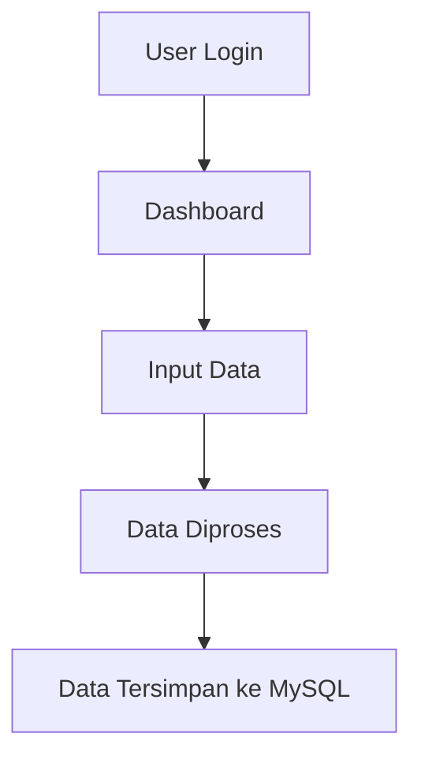
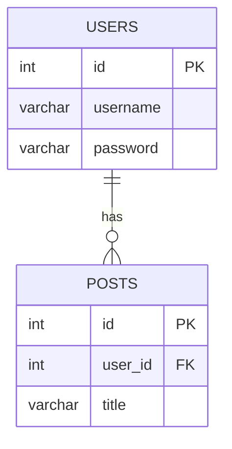

```md
# Prompt Generate README.md Project PHP Native + MySQL

Buatkan file `README.md` yang profesional, modern, dan lengkap untuk sebuah project web berbasis **PHP Native** dan **MySQL** yang dibuat menggunakan **Antigravity**.

README harus menggunakan format Markdown yang rapi dan mudah dipahami, cocok untuk portfolio GitHub maupun dokumentasi project kampus.

## Isi README yang wajib dibuat

### 1. Judul Project
- Nama project
- Deskripsi singkat project
- Tujuan project
- Teknologi yang digunakan

### 2. Overview Project
Jelaskan secara detail:
- fungsi utama aplikasi
- target pengguna
- fitur utama
- manfaat aplikasi
- konsep kerja sistem

Gunakan bahasa yang profesional namun mudah dipahami.

### 3. Tech Stack
Buat tabel teknologi:
- PHP Native
- MySQL
- HTML
- CSS
- JavaScript
- Bootstrap/Tailwind (jika ada)
- Antigravity

### 4. Struktur Folder Project
Tampilkan struktur folder project dalam bentuk tree.

Contoh:
```bash
/project-root
│── assets/
│── config/
│── database/
│── pages/
│── process/
│── templates/
│── index.php
└── README.md
```

### 5. Workflow / Alur Kerja Sistem

Buat penjelasan workflow lengkap dari aplikasi.

Gunakan:

* penjelasan step-by-step
* diagram workflow berbentuk Mermaid

Contoh:



Workflow harus menjelaskan:

* alur user
* proses backend PHP
* interaksi database MySQL
* validasi data
* output sistem

### 6. ERD (Entity Relationship Diagram)

Buat:

* penjelasan relasi database
* tabel utama
* primary key
* foreign key
* hubungan antar tabel

Gunakan diagram Mermaid ERD.

Contoh:



### 7. Fitur Utama

Buat list fitur seperti:

* Login & Register
* CRUD Data
* Search
* Pagination
* Authentication
* Session Management
* Export Data
* Responsive UI

### 8. Instalasi Project

Buat panduan instalasi lengkap:

* clone repository
* import database MySQL
* konfigurasi database
* menjalankan Apache & MySQL
* akses localhost

Gunakan format bash/code block.

### 9. Konfigurasi Database

Buat contoh file konfigurasi:

```php
$conn = mysqli_connect("localhost", "root", "", "database_name");
```

### 10. Screenshot Section

Buat placeholder screenshot:

```md
## Screenshot

```

### 11. Future Development

Buat beberapa pengembangan lanjutan:

* REST API
* JWT Authentication
* Export PDF
* Dark Mode
* Notification System
* Role Management

### 12. Author

Buat section author/profil developer.

---

## Gaya Penulisan

* Modern
* Profesional
* Clean documentation
* Rapih seperti project open-source GitHub
* Gunakan emoji secukupnya
* Gunakan heading markdown yang jelas
* Gunakan tabel jika diperlukan

## Output

Hasil akhir HARUS langsung berupa isi lengkap file `README.md` siap pakai.

```

```
